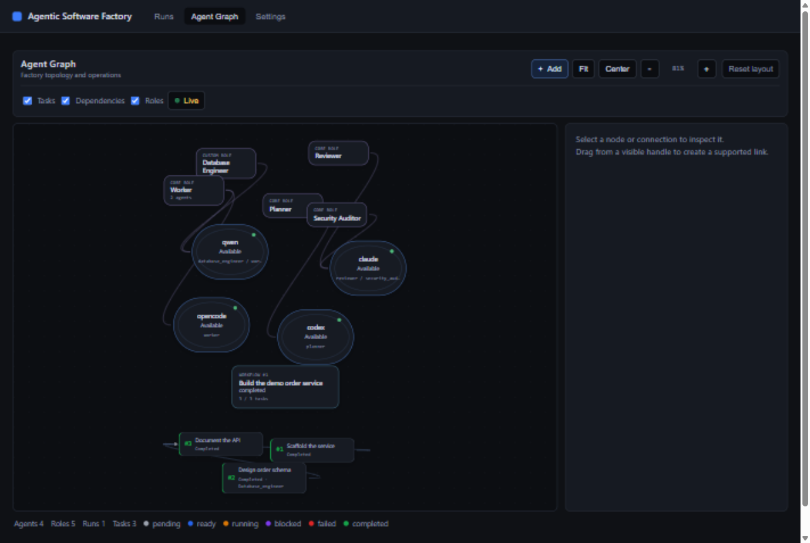

# Agentic Software Factory

A local multi-agent software engineering runtime that turns an objective or GitHub
Issue into a planned, reviewed and integrable software workflow using the coding
agents you already use.

Factory does not provide models. It orchestrates agents.

You install coding CLIs — Codex, Claude Code, OpenCode, Gemini CLI, Qwen Code, or
your own — and Factory plans the work into a real task DAG, runs tasks in isolated
Git worktrees, reviews the evidence, integrates approved work onto a per-run branch,
and can deliver it as a pull request. All state stays on your machine.



```text
Objective / GitHub Issue
        ↓
      Planner
        ↓
   Editable Task DAG
        ↓
┌───────┼────────┐
Worker  Worker   Specialist
        ↓
     Reviews
        ↓
 Integration Engine
        ↓
factory/run-<id>
        ↓
   Pull Request
```

## Why Factory

- **Coordinate several independent coding agents.** Agents share roles; Factory
  decides which agent handles each dispatch and records every invocation.
- **Turn objectives into dependency-aware plans.** The Planner produces a task DAG
  you can inspect before anything runs.
- **Isolate implementation in Git worktrees.** Every task works on its own branch;
  approved work is integrated onto `factory/run-<id>`. Your main branch is never
  touched.
- **Review before integration.** A task completes only after structured Reviewer
  approval; specialized reviews can route `request_changes` into bounded rework.
- **Preserve durable workflow state.** Runs, tasks, attempts, sessions, evidence,
  artifacts, and plan revisions live in local SQLite and survive restarts.
- **Route work according to agent performance.** Opt-in deterministic routing ranks
  eligible agents from measured local history.
- **Enforce role/policy boundaries.** Roles say what an agent should do; policies
  say what it is permitted to do. Deny wins, and Factory's safety invariants always
  apply.
- **Replan unfinished work without rewriting history.** Plan changes are stored as
  durable revisions; completed tasks are never silently rewritten.
- **Connect GitHub Issues to pull requests.** Import an Issue, run the normal
  pipeline, and deliver the completed run as a PR through the locally authenticated
  `gh` CLI.
- **Expose controlled MCP tools.** External tools reach task agents only through
  policy-mediated, scoped grants — and their results stay untrusted data.

Simple workflows stay simple: a small fix still plans as Worker → Reviewer.

## How it works

```text
Agent Graph → local API → Factory Core → Planner → task DAG
                                      → task worktrees → evidence
                                      → Reviewer → approve or retry
                                      → Integration Engine → factory/run-<id>
```

- **Plan** asks the selected Planner for structured tasks and dependencies without
  changing the repository. Tasks may target specific roles from the workflow's team.
- **Start** validates the team, the Git repository, the DAG, and each task's
  effective policy, then runs ready tasks one at a time in isolated worktrees.
- **Every task is dispatched by role and operation.** Each attempt is an
  `AgentSession` that records the role, the agent, and the policy that applied.
- **Process exit is not completion.** A task completes only after structured
  Reviewer approval. Worker failures and change requests retry up to three total
  attempts; policy blocks never consume retries.
- **Approved work is integrated.** The Integration Engine lands each approved
  implementation-family task on the run's `factory/run-<id>` branch; a completed
  run can be delivered as a pull request.

The Rust Factory process owns execution — closing the browser does not stop active
work. All state lives in `.factory/`:

```text
.factory/
  db.sqlite3          workflows, tasks, attempts, sessions, artifacts, and audit
  config.toml         agents, role assignments, policies, and MCP servers
  recipes.toml        custom workflow recipes (created on first save)
  graph.json          saved positions, visual nodes, and custom links
  context/index.json  bounded repository context index
  worktrees/t<id>/    one Git worktree per task
```

## Core capabilities

| Capability | What it does | Reference |
| --- | --- | --- |
| Role-aware multi-agent workflows | Eight core roles plus custom roles; every task carries a role and a semantic operation validated against the role's execution class. | [Roles](docs/roles.md) |
| Parallel-ready execution | Multiple workflows run concurrently with capacity-aware agent selection; per-run task width and per-agent concurrency are configurable. Task scheduling within one run is sequential in this release. | [Architecture](docs/architecture.md#workflow-lifecycle) |
| Plan inspection and durable revisions | Inspect the generated DAG and the team before start; plan edits and partial replans persist as durable revisions that never rewrite completed work. | [Architecture](docs/architecture.md#workflow-lifecycle) |
| Git Integration Engine | Approved tasks land on the per-run `factory/run-<id>` branch, ready for a pull request; `main` is never modified. | [GitHub](docs/github.md) |
| Repository Context Engine | A bounded, read-only index of paths, symbols, and related tests is injected into every mission. | [Architecture](docs/architecture.md#repository-context-engine) |
| Policy / Permission Engine | Project-local filesystem, command, environment, Git, network (advisory), and tool policies per role and agent. | [Policies](docs/policies.md) |
| GitHub Issue → Workflow → PR | Import an Issue as a normal workflow and deliver the completed run as a pull request. | [GitHub](docs/github.md) |
| Agent Evaluation & Performance | First-pass approval, retries, durations, and integration quality measured from local history, with honest sample sizes. | [Evaluations](docs/evaluations.md) |
| Intelligent Agent Routing | Deterministic round-robin by default; opt-in performance routing ranks eligible agents from measured history. | [Routing](docs/routing.md) |
| Workflow Recipes | Reusable workflow configuration — roles, routing, concurrency, policy presets, Planner guidance — snapshotted immutably per run. | [Recipes](docs/recipes.md) |
| External Tools / MCP | Policy-mediated access to MCP servers with scoped grants, limits, and audit; results are marked untrusted. | [MCP](docs/mcp.md) |

## Install

Ready-made binaries are available for Windows (x86_64), Linux (x86_64), and macOS
(Apple Silicon and Intel). No Rust, Node, or administrator rights are required.

**Windows**

```powershell
irm https://raw.githubusercontent.com/OmegaMc1331/agentic-software-factory/main/install.ps1 | iex
```

**Linux / macOS**

```bash
curl -fsSL https://raw.githubusercontent.com/OmegaMc1331/agentic-software-factory/main/install.sh | sh
```

Then check the install:

```bash
factory --version
```

The installers download release archives over HTTPS and verify their published
SHA-256 checksums. If `factory` is not found, open a new terminal: Windows adds the
install location to your user PATH; macOS and Linux print the line to add to your
shell profile. Running the installer again replaces an older version with the latest
release.

**Uninstall** — remove the binary and any PATH entry you added:

- Windows: delete `%LOCALAPPDATA%\Programs\AgenticSoftwareFactory`, then remove its
  `bin` directory from your user PATH under **System Properties → Environment
  Variables**.
- macOS / Linux: `rm ~/.local/bin/factory`.

Your project-local `.factory/` state is not removed.

## Quick start

```bash
cd my-project
factory init
factory start
```

`factory init` creates `.factory/` with a starter configuration: example agent
entries (Codex, OpenCode, Claude Code), pipeline role assignments, and policy
presets for the core roles. `factory start` serves the local API and dashboard,
waits until the server is ready, then opens `http://127.0.0.1:4321`.

In Agent Graph:

1. **Configure and authenticate your coding agents.** Factory never talks to model
   providers; each CLI keeps its own authentication.
2. **Assign Planner, Worker, and Reviewer.** A fresh configuration assigns all
   three pipeline roles already; adjust them to the agents you actually have.
3. **Create a workflow** from an objective, or import a GitHub Issue.
4. **Inspect the generated plan** — tasks, dependencies, roles, and operations —
   and edit the team before starting.
5. **Start** the workflow.
6. **Inspect execution** — attempts, evidence, reviews, artifacts, and the
   integration branch — from the Workflow Inspector and Performance view.
7. **Optionally create a pull request** from the completed run.

## Agents and roles

Three concepts, deliberately separate:

```text
Agent      = an executable coding CLI you install and authenticate
Role       = a responsibility inside Factory
Assignment = permission for an agent to perform a role
```

```text
Codex                    Claude
 ├─ Planner               ├─ Reviewer
 ├─ Worker                └─ Security Auditor
 └─ Reviewer
```

A role can be filled by several agents, and one agent can hold several roles — no
`worker2`-style duplicates. Roles are agent-independent: whichever assigned agent
executes a role, the responsibility, operation semantics, and policy stay the same.

- Role system reference: [docs/roles.md](docs/roles.md)
- Designing custom roles: [docs/role-design-guide.md](docs/role-design-guide.md)

## Example workflow

Objective: *"Add rate limiting to the public API endpoints."*

```text
Planner produces the DAG
  1. Architect        advisory      rate-limiting design, constraints      → artifact
  2. Worker           implement     middleware + configuration (needs 1)   → evidence
  3. Test Engineer    verify        regression tests (needs 2)             → artifact
  built-in Reviewer approves each implementation-family attempt
  Integration Engine lands approved work on factory/run-7
```

- Task 2 runs in `.factory/worktrees/t2`, consumes the Architect artifact of its
  dependency, and is reviewed against its acceptance criteria.
- Task 3 bases its worktree on the already-integrated head, so it tests what task
  2 actually changed.
- When the run completes, **Create Pull Request** pushes `factory/run-7` and opens
  a PR whose body is generated from recorded evidence — never invented.

## Security and trust model

- Factory is **local-first**: state lives in `.factory/`, and nothing is sent to
  external services.
- The API **binds to `127.0.0.1`** and requires a short-lived same-origin browser
  session with Host/Origin checks and CSRF protection. It is still a local trust
  boundary: do not proxy or expose it.
- Task worktrees are **Git isolation, not OS sandboxing**.
- External coding agents **retain the OS permissions of the user** who started
  Factory.
- The **Policy Engine provides orchestration-level controls** (filesystem scopes,
  command allow/deny, environment filtering, Git limits) enforced at Factory's
  boundaries and against recorded evidence — it is not a process sandbox.
- **Network restrictions may not be enforceable** at the OS level; network policy
  is advisory on all current platforms.
- **MCP results and GitHub Issue content are treated as untrusted data** and can
  never change roles, permissions, or output contracts.

Run agents you trust. See [docs/security.md](docs/security.md) for the full model.

## Documentation

| Guide | Purpose |
| --- | --- |
| [Architecture](docs/architecture.md) | How Factory is structured |
| [Roles](docs/roles.md) | Role system and runtime reference |
| [Designing Effective Roles](docs/role-design-guide.md) | How to create effective custom roles |
| [Policies](docs/policies.md) | Permissions and boundaries |
| [Evaluations](docs/evaluations.md) | Agent performance metrics |
| [Routing](docs/routing.md) | Intelligent agent routing |
| [Recipes](docs/recipes.md) | Reusable workflow strategies |
| [GitHub](docs/github.md) | Issue → Workflow → Pull Request |
| [External Tools / MCP](docs/mcp.md) | External tool integration |
| [API](docs/api.md) | Local HTTP API reference |
| [Development](docs/development.md) | Build, test, and contribute |
| [Security](docs/security.md) | Trust and security model |

The local dashboard communicates with a semantic API bound to `127.0.0.1`
(default port `4321`). See [docs/api.md](docs/api.md).

## Development

See [docs/development.md](docs/development.md) for source builds, tests, and the
embedded dashboard release build, and [CONTRIBUTING.md](CONTRIBUTING.md) for the
contribution principles. Quality gates:

```bash
cargo fmt --all -- --check
cargo clippy --workspace --all-targets -- -D warnings
cargo test --workspace
```

```bash
cd apps/dashboard
npm ci && npm run format:check && npm run lint && npm run typecheck && npm test && npm run build
```

## License

MIT. See [LICENSE](LICENSE).
