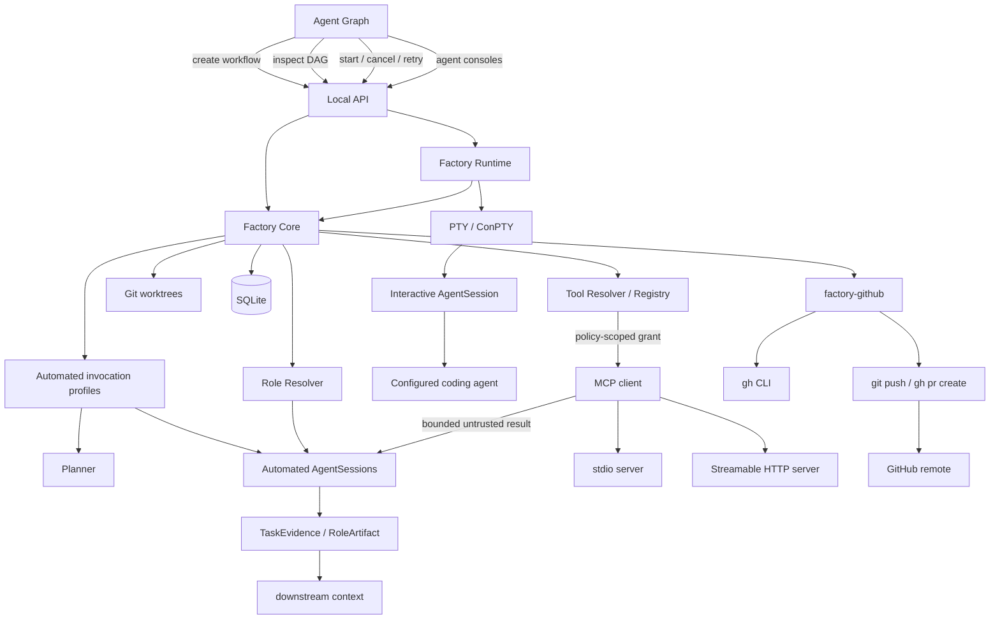

# Architecture

Agentic Software Factory is a local Rust application with a React dashboard. The API
binds to `127.0.0.1`. Durable execution state lives in SQLite, agent configuration in
TOML, and visual graph state in JSON. Each task runs in a Git worktree.



The dashboard requests semantic Factory operations. It does not execute arbitrary
shell commands.

## Workspace structure

```text
crates/
  factory-types     Run, Task, TaskOperation, RoleArtifact, TaskAttempt, evidence,
                    review, session, and GitHub linkage/delivery types
  factory-agent     Configured subprocess execution, output capture, cancellation
  factory-policy    Policy model, precedence resolver, path/environment enforcement
  factory-mcp       MCP configuration, discovery, deterministic tool resolution,
                    scoped grants, transports, limits, leases, and invocation audit
  factory-db        SQLite persistence and versioned migrations
  factory-git       Repository checks, worktrees, and Git evidence
  factory-core      Planning, invariants, mission building, task transitions, and
                    execution policy
  factory-github    gh CLI adapter, remote parsing, bounded Issue import, and the
                    Factory-owned delivery engine (push + pull request)
  factory-runtime   In-process background workflow ownership
  factory-eval      Read-only agent performance measurement from workflow history
  factory-api       Explicit local HTTP operations and session streams
  factory-cli       Bootstrap/runtime CLI: init, start, status, dev
apps/
  dashboard         React, TypeScript, and @xyflow/react
```

Dependencies point toward `factory-types`. The CLI and API use Factory Core; the API
also owns one `factory-runtime` instance for background operations.

## External tool boundary

MCP is centralized in `factory-mcp`; agents and workflow code do not open MCP
connections directly. Factory discovers and caches server metadata, composes role,
agent, and Recipe tool policy, selects a bounded relevant catalog without an LLM, and
issues a hashed, expiring grant scoped to the concrete run/task/attempt/session.
`factory mcp call` is the provider-neutral bridge that revalidates that grant and the
current policy before `tools/call`.

Per-server SQLite leases provide concurrency limits without a global mutex. Database
operations are short and never span external I/O. Invocation guards make cancellation
terminal and auditable. Results are bounded and remain marked external data rather
than repository truth. See [External Tools / MCP](mcp.md).

## Dashboard request deadlines

The dashboard applies a deadline per semantic API operation rather than one global
HTTP timeout:

| Policy            | Deadline | Used by                                                                   |
| ----------------- | -------: | ------------------------------------------------------------------------- |
| default           |      5 s | ordinary reads and mutations, including workflow 202/204 acknowledgements |
| discovery         |     15 s | MCP connection tests and tool discovery                                   |
| externalOperation |    120 s | GitHub status, PR previews, Issue imports, and pull request creation      |

MCP discovery uses the larger of 15 s and the server's configured discovery timeout
plus 5 s, capped at 605 s. The backend's maximum MCP timeout is 600 s. Settings passes
that derived value for the specific server being tested or inspected.

A deadline only bounds how long the dashboard waits. It does not cancel server-side
work. After an uncertain write timeout, the dashboard does not retry the mutation
automatically. Pull request creation performs one delivery-status reconciliation,
blocks retry while delivery is `pushing` or `creating_pr`, and only offers retry when
the persisted state is `failed` or confirms that no pull request exists. An
unconfirmed status remains blocked.

All requests remain same-origin, mutations retain CSRF protection, and one session
refresh is attempted for 401/403 responses. Network failures and timeouts are never
retried automatically.

## Repository Context Engine

`factory-context` builds a bounded, persisted index of the repository — paths,
languages, and regex-extracted symbols — stored at `.factory/context/index.json`,
searches it with ripgrep (pure-Rust fallback), and deterministically resolves the
most relevant files, symbols, and related tests for a task. Factory Core renders
the result as the `REPOSITORY CONTEXT` section of every automated mission
(implementation, verification, advisory, and review invocations).

The engine is read-only with respect to the repository: it never executes
repository code, never follows symlinks, prunes the search space through ignore
rules, and caps every indexed read and every rendered output. The `[context]`
table in `.factory/config.toml` controls it (`enabled`, `max_files`, `max_chars`,
`include_tests`, `include_symbols`).

Ignore policy (ASF-N07): the engine honors **repository-local rules only** — the
root `.gitignore`, nested `.gitignore` files (deeper files override shallower,
gitignore(5) precedence, and files under an excluded directory can never be
re-included), and `.git/info/exclude` — layered under Factory's built-in
exclusions (`.git`, `.factory`, build/vendor directories, binary and lockfile
patterns), which nothing can negate. User-global excludes
(`core.excludesFile`) are deliberately not consulted, so indexing and search
are identical on every machine; when ripgrep is available it runs with
`--no-ignore` and Factory's compiled rules are the single exclusion policy for
indexing, symbol search, content search, and excerpt extraction alike.
Gitignore parsing is Unicode-safe (patterns with multi-byte characters parse
and match per character, never per byte).

## Evaluation

`factory-eval` measures agent performance (first-pass approval, retries,
durations, integration quality, …) by deriving metrics from the immutable
workflow history — it observes only and never influences scheduling.
Definitions and formulas live in [evaluations.md](evaluations.md).

## Workflow lifecycle

A new workflow is persisted as `planning` before the Planner starts. Planning is a real
`AgentSession`; successful structured output is validated and persisted atomically as
tasks and dependencies. The workflow then becomes `planned`, and repository work does
not begin until **Start** is selected.

A workflow may be created from a **recipe** — reusable configuration (selected roles,
routing/concurrency defaults, policy preset references, bounded Planner guidance).
The recipe pre-fills the team, its routing preference overrides the project default
for that run, its policy presets narrow the effective policies, and an immutable
snapshot is stored on the run; later recipe edits never mutate existing workflows.
Recipes never contain the DAG — the Planner generates it. See
[Recipes](recipes.md).

```text
planning → planned → active → completed
                    │       ├→ failed
                    │       └→ blocked
                    └────────→ cancelled
```

A `blocked` run keeps its tasks untouched and can be started again once the blocking
problem (typically a policy or dependency issue) is fixed; starting re-validates
everything from scratch.

Start validates the workflow team (planner, workers, reviewers, and any additional
roles), the Git repository, the task DAG, the presence of planned tasks, and every
task's effective policy — a task that cannot legally execute blocks the run before
any agent process starts, without consuming retries. The first runtime is sequential:

```text
lowest-position ready task
  → resolve its role, operation, and agent
  → create or reuse its worktree
  → AgentSession (role = actual role id, operation)
  → capture Git and agent-reported evidence
  → dispatch by operation:
      advisory    → persist role artifact → task completed
      review      → evaluate diff + evidence → approve, or request_changes → rework
      implement / verify / post_process → produce evidence → built-in Reviewer
                                            → approve, or retry
  → select the next ready task
```

Teams come only from `.factory/config.toml` role assignments. Every workflow stores a
team snapshot: which planner, workers, reviewers, and additional roles participate.
Global assignments answer which agents *may* act as Worker; the team decides which
ones *do* for that workflow. Tasks may name a role (assigned by the Planner from the
team's role catalog) and an operation; a task without a role defaults to Worker and
an operation-less task derives one from the role's execution class. See
[Roles](roles.md) for the full model.

The built-in Reviewer receives
the task objective, acceptance criteria, diff evidence, Worker output, and relevant
upstream artifacts. Its JSON decision must be `approve` or `request_changes`. Change
requests, verification failures, and Worker failures are limited to the bounded
`TaskAttempt` count per task. Specialized review tasks (`operation: review`) return a
structured `{decision, findings[{severity, summary, evidence}]}` result; a
`request_changes` decision routes back to the implementation task the review
evaluated (bounded rework) instead of failing the workflow. Within a team of several
workers, execution attempts route round-robin; review attempts rotate across the
selected reviewers. Selection is a deterministic function of persisted state and
survives restarts.

Cancellation sets a run-scoped signal, stops scheduling, terminates the current
configured agent process tree, and preserves the worktree and recorded evidence. A
Factory restart marks formerly running sessions and attempts as `interrupted`, running
tasks as `failed`, and active/planning workflows as `failed`; the graph can then expose
the failure and eligible retry.

### GitHub linkage and delivery

`factory-github` closes the loop from GitHub Issue to pull request without adding a
second execution engine. An imported Issue becomes the run's objective and a persisted
untrusted link (`github_links`); planning and execution are the normal pipeline, with
every mission carrying an explicit untrusted-context notice. After a run completes,
the delivery engine (`github_deliveries`) is the only code in Factory that constructs
a `git push`: it pushes exactly `factory/run-<id>` — never force, never user branches —
after verifying completion, integration-head equality (branch drift blocks
publishing), and base-branch availability, then creates (or links an existing) pull
request through `gh`. Delivery state (`not_ready → ready → pushing → creating_pr →
published`, plus `failed`) is persisted separately from `RunStatus` and survives
restarts. See [GitHub](github.md).

## Role model

Role definitions are independent from agents. Core roles (Planner, Worker, Reviewer,
Architect, Researcher, Test Engineer, Security Auditor, Documentation Writer) are
built in; custom roles are `[roles.<slug>]` tables in `.factory/config.toml`. A role
definition says what a role does; a `[[role_assignments]]` entry permits one agent
to perform it. One role may have several agents, one agent may hold several roles,
and at most one assignment per role is preferred.

Four distinct concepts drive the role-aware runtime:

```text
RoleDefinition   what a role is allowed and asked to do (name, instructions,
                 execution class)
RoleAssignment   configuration that permits one agent to perform one role
TaskOperation    what a planned task does (advisory, implement, verify, review,
                 post_process) — validated against the role's execution class
RoleArtifact     the persisted output of an advisory/verification/review task that
                 downstream tasks consume along the dependency DAG
```

```text
RoleDefinition
      │
      ├── Core (built-in ids)
      └── Custom ([roles.<slug>] in config.toml)
             │
             ▼
      RoleAssignments  ── many-to-many ──  Agents
             │
             ▼
         Workflow team snapshot (runs.team)
             │
             ▼
        Tasks (tasks.role, default worker; tasks.operation, derived default)
             │
             ▼
           Runtime dispatch by operation
```

Runtime resolution for one execution attempt:

```text
task role + task operation → workflow team assignment set for that role
→ candidate filtering (policy, availability) → routing mode
→ selected agent (capacity reserved atomically)
→ AgentSession(role = actual role id, operation)
→ TaskAttempt(role, operation, agent) + RoutingDecision audit record
```

Routing is deterministic and local. The default `round_robin` mode keeps the
historical behavior: the preferred assignment is the default team selection,
execution attempts cycle the selected agent pool by persisted attempt count,
and review attempts rotate by attempt number. Projects can opt into the
`performance` or `manual` modes (`[routing]` in `config.toml`): performance
mode ranks eligible candidates by a documented score over reliable
`factory-eval` history (Wilson-bounded quality first, capacity-aware, with
round-robin fallback when data is thin). Every dispatch persists an
explainable routing decision. See [routing.md](routing.md). Execution stays
sequential; the pool topology is parallel-ready and capacity reservations are
atomic.

### Operation dispatch

The mission for every task is assembled by one centralized role-aware mission builder
in Factory Core. It composes the role definition, the operation's semantics and
output contract, the run objective, the dependency-aware upstream context, and a
`PERMISSIONS` section rendering the session's effective policy. See
[Roles — Execution classes and operations](roles.md#execution-classes-and-operations)
for the compatibility matrix and per-operation behavior.

## Policy engine

`factory-policy` owns the policy model and the single resolver. Policies are
project-local (`[policies.roles.<id>]` / `[policies.agents.<name>]` in
`.factory/config.toml`) and merge with fixed precedence — Factory safety invariants,
then the role policy, then agent-specific restrictions — into one `EffectivePolicy`
per running (role, agent) pair:

```text
PoliciesConfig.effective(role, agent) → EffectivePolicy
  filesystem   repository-relative read/write/deny glob scopes
  commands     unrestricted / restricted / denied, executable-name matching
  network      allow / deny (advisory only)
  environment  allow/deny lists applied before process launch
  git          read + commit-in-task-worktree; dangerous ops are invariants
```

Factory Core consumes that one resolution at every boundary: the pre-start gate
(blocks a run when a task cannot legally execute, without consuming retries),
policy-aware agent selection within a role's pool, the child process environment
(replace-instead-of-inherit when filtering), secret redaction of denied values in
captured output, post-attempt evidence checks (changed files and reported commands),
and the compact `AgentSession.policy_audit` snapshot. The API serializes
`PolicyView`s derived from the same effective policies for the dashboard's
Permissions sections. Permission logic is never duplicated in the runtime, API, or
frontend. See [Policies](policies.md) for the model, presets, and the precise
enforcement boundary.

Workflow recipes (`factory-core/src/recipes.rs`) apply policy presets through the
same resolver as one extra **only-narrowing** layer —
`PoliciesConfig::effective_restricted(role, agent, recipe_preset_scope)` — so a
recipe can restrict what a run's roles may do but can never widen the Policy
Engine's decision. See [Recipes](recipes.md).

## Persistence and concurrency

SQLite tables include `runs`, `tasks`, `task_dependencies`, `task_attempts`,
`agent_sessions`, `role_artifacts`, `github_links`, and `github_deliveries`.
`TaskAttempt` stores the attempt number,
agent, role, operation, status, timestamps, worktree, commit, exit code, error,
evidence, and structured review. `runs.team` stores each workflow's team snapshot,
`runs.recipe` stores the immutable recipe snapshot a workflow was created from
(configuration only — roles, routing, concurrency, policy presets, guidance —
never tasks or history), `tasks.role` and `tasks.operation` preserve what was planned, `task_attempts.role`
and `task_attempts.operation` preserve what actually ran, and `role_artifacts` stores
the structured outputs advisory/verification/review tasks persist for downstream
consumption. `github_links` holds the imported Issue a run was seeded from (untrusted
external context, bounded at import), and `github_deliveries` holds each run's
delivery state and pull request metadata so duplicates are prevented across restarts.

SQLite uses WAL mode and a bounded busy timeout. API handlers hold their shared
connection only for short reads or writes. Runtime jobs open separate Factory/database
connections, so no API mutex is held while an external agent runs. Automated stdout and
stderr are each retained in full up to a 1 MB limit, then as bounded head and tail
segments; the middle omitted bytes are counted. `AgentSession.output_meta` records the
limit, total emitted bytes, dropped bytes, and truncation flags per stream. Structured
planner/worker/reviewer output that exceeds the stdout limit is rejected before parsing
rather than parsed from a partial document. Session output writes remain short and
SQLite is also capped per stream as defense in depth.

The Rust process owns background planning and execution. Browser reloads do not stop a
workflow. This is an in-process runtime; it does not use an external queue or continue
subprocesses across a Factory process restart.

### Migrations

The schema is versioned through `schema_migrations`. The role-aware release adds
version 6: `tasks.operation`, `task_attempts.operation`, `agent_sessions.operation`,
and the `role_artifacts` table. Rows persisted by earlier releases get a compatible
operation backfilled by the migration (known core role ids map to their natural
operation; everything else defaults to `implement`), so upgrading never requires
deleting `.factory/db.sqlite3` and old workflows remain readable and runnable.
Version 17 adds `agent_sessions.output_meta` as nullable JSON, so existing sessions and
interactive consoles remain valid without backfilling process output.

## Agent invocation modes

Factory keeps automated work and user-driven terminals separate:

```text
Planner / Worker / Reviewer / advisory / review agents -> non-interactive process
        -> stdout / stderr -> exit
Agent Console               -> PTY or ConPTY          <-> terminal WebSocket
```

An agent profile defines its executable, workflow arguments, prompt transport, and
interactive arguments. Codex uses stdin for the mission (`codex exec`), while the
other known profiles use their configured argument transport (`claude -p`, `opencode
run`, `gemini -p`, and `qwen -p`). Legacy known configurations are inferred without
rewriting their TOML; unknown legacy configurations remain custom stdin agents.
Custom argument transport replaces one complete `{mission}` argument or appends the
mission as one argument. No shell interpolation is used.

`AgentSession.mode` distinguishes `automated` workflow invocations from `interactive`
console invocations. Automated output remains split into stdout and stderr and streams
through SSE. Interactive output is the PTY's combined terminal byte stream and uses a
session-scoped WebSocket for input, output, and resize. Windows uses ConPTY; Linux and
macOS use the platform PTY through `portable-pty`.

### Interactive terminal backpressure

The runtime retains at most **1,000,000 bytes** of terminal history per session. That
history is the reconnect snapshot; it is not a complete terminal-lifetime log. Each
WebSocket subscriber has an independent bounded queue:

- **2,097,152 bytes** of queued output.
- **256** queued chunks.
- At most **8** subscribers per live terminal.

The queue limits are deliberately redundant. The PTY reader uses 8 KiB chunks, so 256
chunks normally reaches the 2 MiB byte limit first. If future code emits larger chunks,
the byte check still bounds memory. A single chunk larger than the byte limit is never
partially delivered: the subscriber is evicted instead, preserving the binary stream
without silent truncation.

Publication from the PTY reader locks the terminal output only long enough to append
history, enqueue one shared chunk per subscriber, and remove overflowed subscribers.
Chunk data is reference-counted across subscribers, and publication uses non-blocking
queue insertion. A slow subscriber cannot block the PTY reader, other subscribers,
terminal input, resize, cancellation, process exit, or persistence.

When a queue reaches either limit, the runtime marks it overflowed, discards that
subscriber's queued chunks, and removes it from the publisher. Bytes already written to
the socket are unaffected, but dropped queued bytes are not replayed. The API closes the
WebSocket with code **1013** and a bounded reason. The terminal process continues
running. A reconnect creates a fresh queue and replays the retained history window;
output older than that window is not recoverable. Dropping a subscription removes it
and releases its queue promptly.

The application-level bound per live terminal is therefore conservatively 1 MiB of
history plus 16 MiB of subscriber queues, plus transient reconnect snapshots (up to
1 MiB each), plus one in-flight WebSocket chunk per connection. WebSocket sends time out
after 15 seconds so a stalled network consumer cannot hold an in-flight chunk
indefinitely. OS socket buffers, the SQLite cache, and other components are outside this
model, so this is not a strict whole-process memory bound.

## API boundary

The complete endpoint reference lives in [api.md](api.md): workflows, tasks,
roles, recipes, agents and sessions, graph and configuration, GitHub,
performance, and external tools / MCP.

Artifacts are read through the explicit artifact routes (or the run detail). The
frontend never invokes agents directly: workflow execution is owned by the runtime,
and the API offers no generic action/command/role-execute endpoint.

Automated output uses session-scoped Server-Sent Events. Interactive terminal traffic
uses WebSocket only after the session ID resolves to a live Factory-owned PTY session.
Both transports close at a terminal state.

## Agent Graph state ownership

The graph merges state without changing its owner:

- `/api/graph` supplies agents, roles, workflows, tasks (with role and operation),
  assignments, active execution links, containment, and dependencies.
- `.factory/graph.json` stores manual positions, groups, notes, memberships, and custom
  agent-to-agent links.
- `.factory/config.toml` stores real agents and role assignments.
- SQLite stores workflows, task DAGs, attempts, evidence, artifacts, and sessions.

Role assignments are editable configuration semantics. Workflow containment and task
dependencies are read-only in this release. Groups, notes, memberships, and custom
agent links are visual topology only and never trigger execution.

## CLI

The public CLI is limited to `factory init`, `factory start`, read-only
`factory status`, and `factory mcp call` (the scoped external-tool bridge used
by task agents), plus `--help` and `--version`. Debugging commands remain under
`factory dev`. Normal workflow creation and operation happen in Agent Graph.

Release builds embed the compiled dashboard with `rust-embed`; development builds read
`apps/dashboard/dist`. See [Development](development.md) and [Security](security.md).
