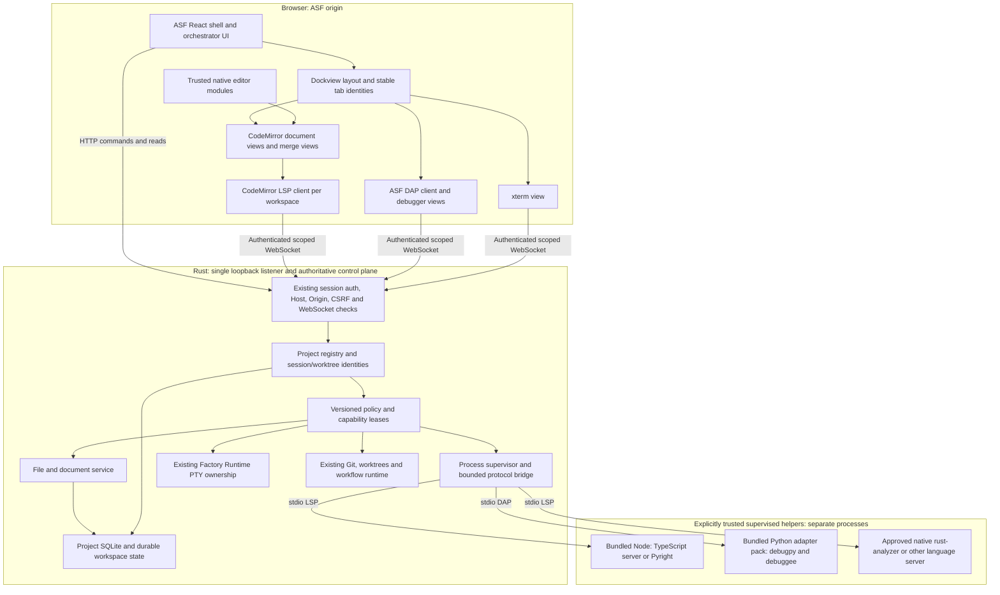
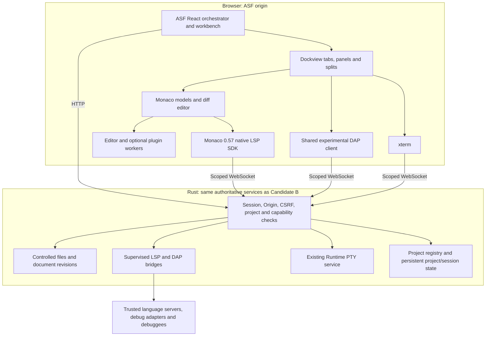

# P01 IDE integration contracts

P09 extends the existing Rust executor with project SQLite migration 21: profile revisions, immutable session configuration snapshots and durable handoffs. Runtime-only overlays map profiles to trusted TOML installations. The existing scheduler, claims, capacity, process supervisor, Reviewer and integration coordinator remain authoritative. Rust validates policy intersection and handoff boundaries; React edits profiles and displays real history. No arbitrary browser command configuration, model-state migration or P10 browser-close suspension is introduced. See [profile architecture](agent-profile-architecture.md) and [qualification matrix](p09-test-matrix.md). Earlier phase boundaries below remain historical delivery descriptions.

Status: architecture proposal supported by the isolated P01 experiments. This document does not implement P03–P14. The [product specification](product-spec.md), [evaluation](ide-evaluation.md) and [ADR](adr-ide-foundation.md) define scope and decision evidence.

## Candidate B: CodeMirror composition

Rust owns all process launches, file writes, persistence and Git effects. Browser code owns view rendering and transient selection. Dockview owns a layout representation, not project authorization or workflow execution. Node is a supervised tool runtime; there is no Node IDE HTTP server, second project registry or Node filesystem API exposed to the browser. The same composition accommodates memory, agents, review and mission views without putting the scheduler in React.

## Candidate A: Monaco composition

The experiment uses the public native Monaco SDK, not a VS Code extension host. Its synchronizer observes global models and lowercases document URIs. Creating an outside-project model caused a request that Rust rejected before forwarding. This is an observed integration limitation, not an authorization bypass. A production Monaco implementation would need scoped providers, an upstream-supported selector/disposal contract, or a separately qualified integration such as monaco-languageclient/Codingame. An iframe per project would add document and accessibility complexity and is not accepted without a new prototype.

## Document and file ownership

Production identity is `(project_id, worktree_id, canonical_document_id)`. An editor group is a view of a document, not a second file owner. Duplicated views share one document authority, synchronized changes and independent cursor/scroll state. CodeMirror's default LSP workspace allows one view per URI; P05/P06 must implement and test its documented `Workspace` interface when duplicating the same document. P01 splits different documents and does not claim this duplicate-view case tested.

Open returns a revision and encoding. Save includes the base revision and an idempotency key; a stale revision fails with a conflict and preserves both buffer and disk. Atomic replacement and durable recovery belong to Rust. External changes become explicit reconcile events. The P01 SHA-256 compare-and-swap and atomic tempfile replacement demonstrate normal conflict handling; they do not close every hostile OS path-swap race. Production must use platform-safe file handles and verify containment at write time, including symlinks/reparse points, hardlinks and worktree roots. No unrestricted path or frontend-selected executable endpoint is proposed.

The production layout envelope contains schema version, project/session/tab identities, layout tree and document recovery references. SQLite migrations and backup policy remain a P03/P04 design requirement. The experiment's `.factory/p01/workspace-*.json` is a versioned persistence proof, not the V2 schema or migration. Buffer/view state restores; serialized undo history is not qualified.

## LSP lifecycle and transport

1. Rust resolves the authorized project/worktree and an allowlisted server profile. The browser cannot choose executable, environment or root directory.
2. Rust acquires a lease keyed by project, worktree, profile and generation, enforces capacity and launches the helper with an environment allowlist. A Windows Job Object or Unix process group owns descendants. Process ownership is separate from sandboxing.
3. A project-bound authenticated WebSocket carries bounded JSON messages; Rust converts stdio Content-Length framing. Document URIs are canonicalized to one identity and checked before child stdin. Responses and request IDs are validated and routed to the owning client.
4. The LSP client synchronizes in-memory document versions; diagnostics are associated with the document version and project. Server-requested edits must return through the file/document authorization and conflict path. Server commands, downloads and dynamic registrations need an explicit handler; they cannot silently become process execution.
5. Disconnect, failure, restart and project closure invalidate the generation. Reconnect obtains a new client, initializes it, then resends current documents. Diagnostic state from an old generation is discarded. Completed protocol messages are not durable workflow events.

P01 demonstrates TypeScript diagnostics and hover in both editors, plus a separate real Pyright session. Its messages are capped at 1 MiB, headers at 8 KiB, traces at 2,000 metadata entries, browser history at 1,000 messages, output channels at 256 messages, active helpers at four and leases at 180 seconds. These are experimental bounds, not finished production resource quotas. P06 must add request-rate/CPU/memory budgets, drain/restart backoff, lag reporting, cancellation and schema validation. The bridge is intentionally a limited allowlist, not a complete LSP implementation.

Rust, TypeScript and Python use independent server profiles and workspace roots. rust-analyzer is not installed in the evaluated toolchain; no Rust-language LSP success is claimed. P06 must qualify real Rust, TypeScript and Python projects, completion, definition/references, rename, formatting and import actions. P01's hover and diagnostics do not satisfy that release gate.

## DAP lifecycle and transport

Debug configurations are project-scoped, versioned data with adapter identity, validated program paths, environment references and policy. Secrets are resolved in Rust at launch and excluded from persistence/events. Rust launches the adapter, owns the debuggee tree, validates source paths and maps project/worktree paths to the debugger's native paths. The browser displays typed responses and events. `runInTerminal`, shell expansion, evaluation, attach and adapter reverse requests each require explicit capabilities; they are not automatically trusted because the adapter requested them.

P01 fixes the program to its owned `debug.py`, launches debugpy, verifies a breakpoint, reads stack/scopes/variables, continues and observes termination. Arbitrary launch arguments are overwritten server-side and evaluate/attach are denied. This is a real protocol feasibility proof, not the full debugger UI. P06 must implement supported launch/attach profiles, continue/pause/step, console, failure handling, cancellation, restart and cleanup. An unavailable adapter is reported unavailable.

## Terminal reuse

The existing Factory Runtime remains the PTY/ConPTY owner. A browser terminal attaches by project/session identity and cannot choose a generic shell command through the probe. Input, resize, reconnect and stop are exercised through the real existing service. A fixed trusted Python probe is deliberately distinct from an agent CLI and from a general development shell.

On this Windows host, portable-pty 0.9.0 returned an error after successful process termination. The experimental adapter retains the error and reconciles against the actual durable finished session and process exit. P06 must fix or upgrade the upstream termination path and add Windows coverage. It must separately design approved shells, working directory/environment, resource limits and agent/development-terminal distinctions. P01 adds no unrestricted terminal API to production.

## Extensions and trust

Native ASF extensions are the selected compatibility contract; VS Code VSIX compatibility is not promised. P01 installs/activates/uninstalls an explicitly pinned bundled CodeMirror YAML module and demonstrates its syntax contribution. Unknown package identifiers are rejected. This is a trusted native module in the UI process, with no crash or privilege isolation. Its package installation state and actual activation are separately verified. Browser module unload does not remove JavaScript already cached by the browser.

The P06 package format must include identity, API version range, license, checksums, activation conditions, commands, views, editor hooks, configuration schema, dependencies and requested capabilities. Rust owns verification, install/update rollback, permission grants and project-specific activation. Packages live in user data outside the installation directory. Conflicts, unsupported API versions, absent adapters and loading failures need visible states and diagnostics. No market compatibility can be inferred from installability.

Trusted builtin editor modules may run in the UI process. Untrusted browser code must not receive the ASF origin's ambient session cookies; an isolated origin/iframe with restrictive CSP and a narrow capability broker is a prerequisite before accepting it. A same-origin Worker provides failure isolation, not privilege isolation. Node/native extensions that use `fs`, network or subprocesses carry the user's OS privileges; logical ASF permissions cannot sandbox them. Support requires an explicit trusted-code policy or separately qualified OS isolation. Arbitrary npm packages and arbitrary marketplace installs remain refused until those requirements exist.

## Packaging and helper supervision

The frontend compiles to assets served by Rust-Embed. Node is needed only by approved tools; Python/debug adapters form an automatically provisioned optional adapter pack. A Windows representative package includes both runtimes and requires no installed Rust/Node/Python to launch the tested editor and tools. [Packaging evidence](ide-evaluation.md#packaging-feasibility) records what was actually executed.

For every runtime: Rust resolves a pinned installed path, verifies integrity/version, starts it without an additional public listener, probes initialization, logs redacted metadata, and applies retry/backoff after a crash. Shutdown first stops scheduling, then disconnects protocols, terminates/waits for descendant trees and reconciles durable terminal status. No uncertain external operation is replayed. Production crash recovery and multi-client leases remain P10, not P01.

The proposed four-target pipeline is in the experiment README. Windows is the only native P01 packaging execution. Linux and both macOS architectures require their own native runtime packs, smoke tests, cleanup checks and signing/notarization as applicable before V2 release. The existing release workflow is unchanged.
## Implemented P06 boundary

`factory-ide` now supplies the Rust-owned LSP, DAP, development-terminal and declarative extension services described in [IDE service architecture](ide-service-architecture.md). They are owned by P03 project contexts, use P05 roots/revisions, and attach to the existing CodeMirror/Dockview workspace. Protocol/process state is distinct from workspace navigation sessions and agent execution sessions. No secondary mandatory Node IDE backend, production conversation engine or P10 workflow suspension is introduced. Actual local qualification and remaining platform/CI gates are recorded in P06 delivery (historical record held privately).

## Implemented P08 boundary

The existing Rust Factory execution loop now owns concurrent dispatch, short SQLite claims, shared application/project/agent capacity and one integration lane per workflow. It reuses the existing semantic task operations, Reviewer, policy engine, MCP grants, Git service and plan revision store. [Scheduler](dynamic-scheduler.md), [worktrees](parallel-worktree-execution.md), [integration](integration-coordinator.md), [replanning](autonomous-replanning.md) and [recovery](scheduler-recovery.md) specify the exact contracts. P07 remains the conversation/progress interface; P09 profiles and P10 browser-close suspension/checkpoints are not introduced.

## P10 implemented boundary

The application-level presence registry authenticates browser-instance leases. Project-local migration 22 owns workspace close intent, mission lifecycle generations, durable commands and bounded checkpoints. The runtime lifecycle coordinator uses the existing P08 scheduler, process supervisor, P03 project lock and P09 handoff records. It does not create a second task scheduler or serialize external model inference. Browser-managed admission and explicit validated logical resume are described in [session-lifecycle.md](session-lifecycle.md). P11 structured project memory remains future work.

## P11 project memory integration

P11 introduces the project-scoped `factory-memory` service with additive SQLite migration 23, versioned claims/provenance, derived local FTS5 search, bounded retrieval, extraction policy and invocation usage references. It extends the existing P07/P08/P09/P10 execution path; there is no second scheduler or global memory store. See [project memory](project-memory-architecture.md).

## P12 implemented boundary

Production Source Control extends existing factory-git, P05 roots, project-local migration24, Reviewer invocation context and the existing GitHub delivery coordinator. The frontend owns presentation only. Primary-root index/commits/branches and read-only managed-worktree inspection share one Git authority; human feedback is distinct from automated review. Existing scheduler, handoff, lifecycle and memory ownership remain unchanged. See [Source Control](source-control-architecture.md) and the P12 delivery (historical record held privately) for executed local evidence and independent release gates. P13 and P14 remain outside this implementation.

## P13 implemented boundary

Product consolidation keeps Dockview and each existing Rust service authoritative. Application preferences extend the existing WorkspaceStore with independent CAS; project settings are a safe read-only facade over current configuration. Project notification materialization retains source-event provenance and independent read/dismiss state. Commands and links invoke existing scoped actions without new execution authority. Indexed memory/Git batch improvements retain the same policy, source, revision, deletion and worktree guards. See [Settings](settings-architecture.md), [notifications](notifications.md), [navigation](product-navigation.md) and the P13 delivery (historical record held privately). V1 routing and P10 manual resume remain unchanged. P14 qualification and V2 release remain pending.
