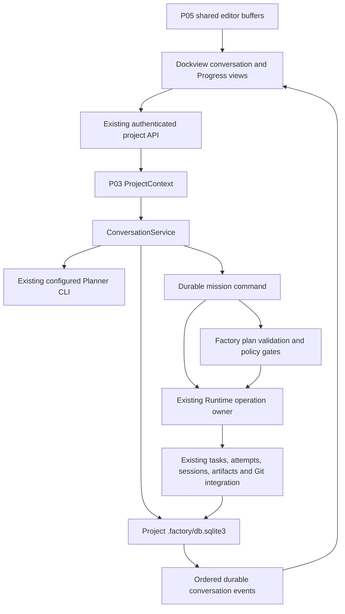

# Project conversations and mission coordination

P07 adds `factory-conversation`, a production application layer over Factory Core and Runtime. `/workspace.html` remains opt-in; V1 remains `/`. The implementation and qualification limits are recorded in the P07 delivery (historical record held privately).

## Identities and ownership

| Entity | Identity and authority |
| --- | --- |
| Project | P03 registry `p_` ID and canonical root; owns the SQLite database, Runtime, file service and conversation service |
| Workspace session | P04 `s_` navigation identity; stored in the accepted command as presentation provenance, never as authorization or an AgentSession ID |
| Conversation | Random `c_` UUID, persisted with its project ID; display-title changes preserve identity |
| Message | SQLite integer local to the owning project, plus conversation identity |
| Command | SQLite integer and unique `(conversation_id, command_key)`; owns one logical accepted request |
| Mission | Existing numeric run ID, always interpreted inside the owning project |
| AgentSession | Existing subprocess record; independently linked through response provenance or mission sessions |
| Event | Increasing SQLite integer inside the project; conversation and project scope are required, not global numeric uniqueness |

A view retains the project ID and selected conversation ID. Two views may select the same conversation or different conversations in the same workspace session. A supplied workspace-session ID is a navigation reference, not proof of a separate user's permissions. The existing local browser authentication is the security boundary. The frontend must not use a navigation-session selection to authorize a request already in flight.

## Schema 19

The additive project migration creates `conversations`, `conversation_messages`, `conversation_commands`, `conversation_events` and `conversation_missions`, with foreign keys and query indexes. Existing runs, tasks, attempts, agents, recipes, grants and worktrees remain in their existing structures. The existing verified SQLite-backup mechanism runs before upgrading an older project database. Pending migrations commit transactionally.

`conversation_accept` persists the user message, response placeholder, command identity, payload fingerprint and accepted event in one transaction. Once accepted, a failure cannot erase the objective. `conversation_begin_run` creates the real run and mission association in one transaction after Factory validates team/recipe resolution. There is no interval in which a second request may create an unassociated duplicate workflow.

Metadata rename/archive uses an expected revision. Archiving preserves all records and prevents new submissions. No automatic history deletion or silent retention purge is implemented. To remove retained source snapshots, stop ASF, preserve a verified database backup/export, and manage the project's local database explicitly; deleting a message row alone is unsafe because commands, associations and evidence reference it. There is no claim of a complete export/delete UI in P07.

Downgrading to P06's executable after a schema-19 upgrade is refused by the existing future-schema guard. Restore a verified pre-upgrade backup while stopped to run the older version. Such a rollback does not preserve messages or workflow changes made after that backup; keep the newer database separately.

## Command lifecycle

1. Validate project/conversation ownership, bounded input and authorized context.
2. Reconcile an existing idempotency key or durably accept a new submission.
3. Reserve an existing application operation permit and process independently of browser components.
4. For chat, reconstruct bounded context and invoke the configured Planner agent for one structured action.
5. Validate that action. For a mission, create its associated run transactionally.
6. Transfer the same permit into Runtime's owned planning/execution operation.
7. Use Factory's Planner or the validated authored plan, then `prepare_start` and the existing execution engine.
8. Persist a result derived from the actual workflow/evidence, independently of agent-written prose.

Stored command states are `accepted`, `processing`, `planning`, `finished`, `failed` and `interrupted`; the schema also reserves the coordinated `running`/`cancelled` vocabulary. The run's persisted state is authoritative for execution progress. A command in the coordination phase does not prove that the run remains in planning. A finished interaction can reference a failed, blocked or cancelled workflow; it does not turn that workflow into success.

There is at most one pending interaction per conversation and two active commands per project. The application-wide existing operation limit remains authoritative. A permit transfers between classification and the run, rather than charging twice for one mission. No new task scheduler or intra-run parallel execution is introduced.

## Failure and recovery

The project-open path reconciles unfinished conversation commands as interrupted after Runtime's existing workflow recovery. No classification, planning, task execution or external publication is automatically repeated on restart. Inspect the linked workflow and recorded sessions before explicitly resubmitting. Missing-agent, authentication, invalid-output, policy and runtime errors retain their messages and links.

An independent bounded observer records real workflow snapshots during active commands. SSE may additionally reconcile active or changed workflow states, including a run started through V1. It does not rescan every settled mission on every stream tick. These are state observations, not a fabricated transcript of every transient internal transition. Persisted task/attempt/session histories remain accessible through workflow details.

Closing or moving a presentation tab unsubscribes its UI after a short grace period. It does not cancel a command, stop an agent, suspend a session or terminate a workflow. P10 will add leases/checkpoints; P07 preserves the current runtime semantics. Explicit cancellation uses the correct project's existing Runtime cancellation path.

## Bounds

| Resource | Limit |
| --- | --- |
| Conversations/project | 10,000; reads at most 100 with a creation-order cursor |
| Messages/conversation | 10,000 rows; reads at most 100, UI renders at most 200 |
| Events/conversation | 50,000; reads at most 100 per batch |
| Conversation text/event storage | 256 MiB checked project budget; a final bounded record can cross the threshold before later writes are refused |
| HTTP submission | 128 KiB |
| User text / objective | 16,000 UTF-8 bytes |
| Attached files | 8, selected content at most 24,000 bytes total; source buffer at most 65,536 bytes |
| Agent response capture | 64 KiB per stream; structured user-facing text at most 24,000 bytes |
| Reconstruction | Latest 24 messages considered, at most 32,000 content bytes; four conversation mission summaries, ten recent project run summaries with 500-character objectives, 32 recipe catalog entries |
| Classification | 180 seconds with existing agent process-tree cancellation |
| Live API requests / SSE clients | 16 ordinary conversation requests / 32 streams application-wide |
| Subscriber queue | 16 entries, nonblocking enqueue; overflow closes that stream for cursor reconciliation |

The byte budget covers message content/provenance and event payloads, not the full SQLite file or pre-existing agent-session/evidence storage. It is not a claim that all Factory data is capped at 256 MiB. SQLite/WAL growth is measured separately. No quota failure is presented as a successful write.

See [interaction](orchestrator-interaction.md), [mission creation](mission-creation.md), [events](conversation-events.md) and [tests](conversation-test-matrix.md).

Conversation read-then-write operations acquire `BEGIN IMMEDIATE` before reading, including acceptance, command transitions, run association and observation updates. This avoids upgrading an obsolete WAL snapshot when the independent observer and an SSE reconciliation race a final summary write. Existing five-second database busy handling is unchanged. The native writer-contention regression covers reservation before snapshot reads. The isolated [WAL reproducer](../../scripts/v2_p07/wal-reproduction.py) captures `SQLITE_BUSY_SNAPSHOT` for the prior sequence. This mechanism follows SQLite's [isolation documentation](https://www.sqlite.org/isolation.html) and [transaction contract](https://www.sqlite.org/lang_transaction.html), retrieved 2026-10-30; the connection-level diagnosis is an inference from that controlled reproduction and the original completed-run/failed-summary fixture, whose generic public error deliberately withheld SQLite internals.

## P11 project memory integration

P11 selects bounded eligible project memories from the current user query before invoking the existing orchestrator. Each real AgentSession has ID/revision/hash usage records. Memory is labelled untrusted context; it cannot authorize actions. Explicit `reference_memories` output resolves owning records and opens management without silently editing facts. See [retrieval](memory-retrieval.md).
