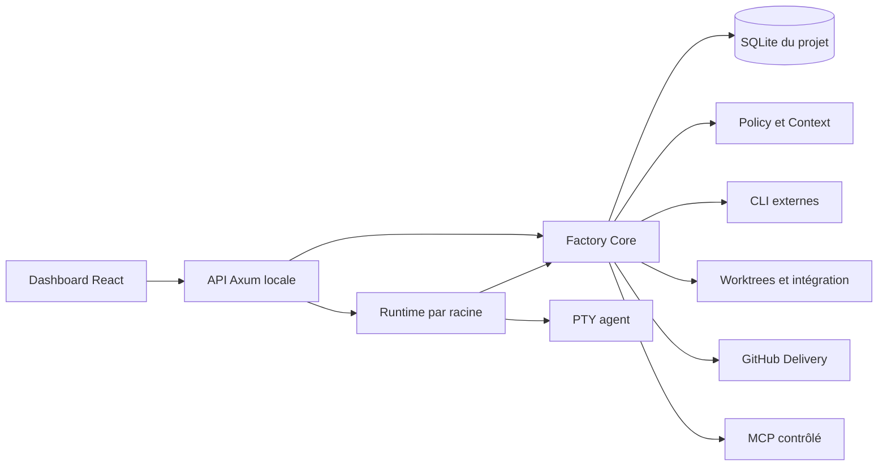

# V2-P00 — architecture actuelle à préserver

Référence inspectée : `580eeaa29117edc7c2a6255341483dc798890f11`, version applicative `1.0.5`. Inventaire de code, distinct de la [cible produit](product-spec.md#6-architecture-technique-cible).

## Responsabilités et dépendances

| Composant | Responsabilité actuelle | Réutilisation V2 |
| --- | --- | --- |
| `factory-types` | Run, Task, opérations, tentatives, sessions d'agents, preuves, artefacts, révisions de plan, routing, recettes, livraisons et MCP | Enrichir les identités ; réutiliser les objets d'exécution |
| `factory-proc` | Supervision bornée des commandes, capture, délais, terminaison d'arbre | Socle des processus ; à étendre pour les services IDE |
| `factory-agent` | Résolution des exécutables, profils CLI, transport du prompt, capture UTF-8, annulation | Conserver les profils et l'authentification externe |
| `factory-policy` | Résolution unique des droits rôle/agent/recette, deny-wins, chemins, filtrage d'environnement, redaction | Ajouter les capacités IDE aux frontières Rust |
| `factory-context` | Index borné, recherche, symboles et sélection du contexte, validation des chemins et lecteurs | Réutiliser la lecture contrôlée ; ce n'est pas la mémoire structurée |
| `factory-db` | SQLite avec migrations transactionnelles 1–18 et stockage des historiques | Évolutions additives et sauvegarde V1 vérifiée |
| `factory-git` | Validation du dépôt, worktrees, preuves Git et intégration | Conserver les espaces isolés et la branche par run |
| `factory-github` | `gh`, import d'Issue, preview, livraison et réconciliation | Conserver les autorisations et les identités d'opération |
| `factory-mcp` | Catalogues, transports, grants hashés, permissions, limites et audit | Conserver la médiation ; ne pas confondre MCP et extensions IDE |
| `factory-eval` | Mesures dérivées de l'historique local et tailles d'échantillon | Préserver la provenance des métriques |
| `factory-core` | Planification, invariants, transitions, missions, tentatives, revue, intégration, routing | Source de vérité de l'exécution |
| `factory-runtime` | Jobs Tokio, signaux d'annulation, PTY/ConPTY, verrou de projet, réconciliation au démarrage | Instancier par projet ; ajouter leases, checkpoints et scheduler |
| `factory-api` | Axum, API sémantique locale, authentification/CSRF, SSE et WebSocket | Routage par identité de projet, contrat de compatibilité V1 |
| `factory-cli` | `init`, `start`, `status`, `mcp call`, commandes `dev` et ouverture navigateur | Compatibilité et packaging à préserver |
| `apps/dashboard` | React 18, TypeScript, Vite, React Flow, xterm, navigation par hash | Évoluer vers un workspace ; pas encore un IDE |

Les 14 crates du workspace restent les propriétaires des capacités réelles. Le frontend transmet des intentions. `ApiState` contient un seul `root`, un mutex SQLite et un `Runtime`. `Runtime::new` canonicalise cette racine, prend `.factory/runtime.lock`, réconcilie les travaux interrompus et conserve le verrou tant que l'instance existe. Le multi-projet ne peut pas être obtenu en changeant globalement `root`.

## Propriété des données

| Emplacement | Contenu et contrat |
| --- | --- |
| `.factory/db.sqlite3` (+ WAL/SHM possibles) | État durable d'exécution, références et historiques ; ne pas copier le seul fichier principal pendant une écriture WAL |
| `.factory/config.toml` | Agents, rôles, assignments, routing, runtime, contexte, politiques et serveurs MCP |
| `.factory/config.toml.bak` | Sauvegarde de la migration de l'ancienne forme rôle → agent |
| `.factory/recipes.toml` | Recettes personnalisées ; les snapshots de runs restent indépendants |
| `.factory/graph.json` | Positions, notes, groupes et liens visuels versionnés ; ce n'est pas un arbre de docking |
| `.factory/context/index.json` | Index de contexte borné, reconstructible ; ne constitue pas des connaissances validées |
| `.factory/worktrees/t<id>` | Espaces Git isolés ; les chemins historiques peuvent être absolus |
| `factory/t<id>`, `factory/run-<id>` | Branches de tâches et d'intégration ; jamais assimilées à une publication distante |

Voir les règles détaillées dans [Architecture V1](../architecture.md), [Sécurité V1](../security.md) et [Développement](../development.md).

## Exécution et limites constatées

- `Factory::execute_active_run_inner` sélectionne une tâche `ready`, attend `execute_task`, puis sélectionne la suivante. Les paramètres de largeur et la capacité par agent existent, mais ne prouvent pas le parallélisme interne à un run.
- Plusieurs workflows peuvent être actifs dans un runtime. Le verrou interdit deux runtimes ASF pour la même racine canonique.
- La réussite d'un processus ne termine pas une tâche d'implémentation sans revue structurée puis intégration. Le plafond des tentatives et les refus de politique restent prioritaires.
- Les modèles `PlanPatch`, `ReplanRequest`, snapshots et révisions existent dans Types/DB ; le routeur actuel n'expose pas de route de modification de plan. Les liens personnalisés du graphe ne sont pas des dépendances exécutables.
- Une `AgentSession` représente une invocation/console d'agent. Ce n'est pas une session utilisateur contenant conversation, onglets et missions.
- Le SSE envoie un snapshot `session` modifié, vérifié toutes les 750 ms, sans identifiant durable ni curseur de replay. La réémission d'un snapshot ne remplace pas un journal d'événements V2.
- La console WebSocket est un vrai PTY d'agent configuré et vivant. Elle n'est pas un shell de développement général. Files d'abonnés et historique sont bornés ; le backpressure ne doit pas bloquer le PTY.
- La fermeture du navigateur ne suspend pas le runtime V1. Les statuts Run sont `planning`, `planned`, `active`, `blocked`, `completed`, `failed`, `cancelled`. Aucun état durable `suspending/suspended/resuming`, checkpoint logique ou lease navigateur n'est présent.
- Le dashboard comporte Runs, Agent Graph, Performance, Settings et détail de run. Aucun explorateur, éditeur, LSP, DAP, gestionnaire d'extensions, conversation persistante ou mémoire structurée n'est implémenté.

## Frontière de sécurité à conserver

L'API écoute sur `127.0.0.1`. Host et Origin sont validés ; sessions signées en mémoire, cookies HttpOnly/SameSite, CSRF sur les mutations, authentification avant SSE/upgrade WebSocket. L'origine de développement est exacte et explicite. Les processus locaux du même utilisateur restent dans le périmètre de confiance.

Les contrôles de politique sont des contrôles d'orchestration, pas un sandbox OS. Le réseau déclaré `deny` reste consultatif. Les agents conservent les droits OS de l'utilisateur. La redaction protège les valeurs connues, avec les limites documentées ; elle n'est pas un détecteur universel de secrets.

Le contexte refuse traversées, liens intermédiaires, reparse points et fichiers hors périmètre. Les ouvertures sont contrôlées avant/après et bornées ; le remplacement malveillant de répertoires parents pendant une ouverture n'est pas couvert par des handles de répertoires épinglés. Cette limite doit rester documentée avant d'ajouter des écritures IDE.

La livraison GitHub utilise des arguments structurés, une branche générée et une confirmation. Une issue/MCP reste une donnée non fiable. `operation_id` et `recovery_required` empêchent le rejeu aveugle d'une publication incertaine ; le verrou de projet précède la réconciliation.

## Inventaire HTTP

Source : `crates/factory-api/src/app.rs::router`, gelée dans [v1-inventory.json](../../scripts/fixtures/v1-inventory.json). 47 motifs, 58 paires méthode/chemin explicitement déclarées : 46 chemins fonctionnels et 57 paires, plus le fallback 404. Axum accepte aussi HEAD sur les routes GET. Les fichiers du dashboard passent par le fallback de service, avec les mêmes contrôles Host/Origin ; ils ne sont pas une API de fichiers du projet.

Le détail des corps, statuts et erreurs existants reste dans [API V1](../api.md). Toutes les routes fonctionnelles sont protégées, sauf health et bootstrap ; le bootstrap vérifie Origin et JSON. Toute mutation protégée exige également le CSRF. Une route présente dans cet inventaire n'autorise aucune nouvelle opération externe.

| Méthodes explicites | Chemin |
| --- | --- |
| GET | `/api/*rest` |
| GET | `/api/agents` |
| GET, POST | `/api/agents/:agent/sessions` |
| GET | `/api/agents/:agent/tools` |
| POST | `/api/auth/session` |
| GET, PUT | `/api/config` |
| GET | `/api/github/status` |
| GET | `/api/graph` |
| GET, PUT | `/api/graph/workspace` |
| GET | `/api/health` |
| GET | `/api/mcp/invocations` |
| GET | `/api/mcp/metrics` |
| GET, POST | `/api/mcp/servers` |
| DELETE, PUT | `/api/mcp/servers/:id` |
| POST | `/api/mcp/servers/:id/test` |
| GET | `/api/mcp/servers/:id/tools` |
| GET | `/api/performance/agents` |
| GET | `/api/performance/agents/:agent` |
| GET, POST | `/api/recipes` |
| DELETE, PUT | `/api/recipes/:id` |
| GET, POST | `/api/roles` |
| DELETE, PUT | `/api/roles/:id` |
| POST | `/api/roles/:id/assignments` |
| DELETE | `/api/roles/:id/assignments/:agent` |
| PUT | `/api/roles/:id/policy` |
| PUT | `/api/roles/:id/preferred` |
| GET | `/api/roles/:id/tools` |
| GET, POST | `/api/runs` |
| GET | `/api/runs/:id` |
| GET | `/api/runs/:id/artifacts` |
| POST | `/api/runs/:id/cancel` |
| GET | `/api/runs/:id/delivery` |
| POST | `/api/runs/:id/delivery/reconcile` |
| GET | `/api/runs/:id/pr-preview` |
| POST | `/api/runs/:id/pull-request` |
| POST | `/api/runs/:id/recipe` |
| POST | `/api/runs/:id/start` |
| PUT | `/api/runs/:id/team` |
| POST | `/api/runs/from-issue` |
| DELETE, GET | `/api/sessions/:id` |
| GET | `/api/sessions/:id/stream` |
| GET | `/api/sessions/:id/terminal` |
| GET | `/api/tasks/:id/artifacts` |
| POST | `/api/tasks/:id/retry` |
| PUT | `/api/tasks/:id/routing` |
| GET | `/api/tasks/:id/routing-decisions` |
| GET | `/api/tasks/:id/routing-preview` |

## Modèles SQLite

16 tables dont `schema_migrations`, 21 index explicites et les index automatiques des clés primaires/contraintes uniques. Les colonnes, défauts, clés étrangères et DDL exacts sont conservés dans l'inventaire JSON ; les cascades et `SET NULL` ne doivent pas être perdus lors de la migration. Les 18 migrations de schéma SQLite sont des versions internes de la V1 produit, pas les versions produit V1/V2.

| Table | Colonnes existantes |
| --- | --- |
| `agent_sessions` | `id`, `run_id`, `task_id`, `role`, `agent`, `command`, `status`, `started_at`, `finished_at`, `exit_code`, `duration_ms`, `stdout`, `stderr`, `attempt_id`, `mode`, `operation`, `policy_audit`, `output_meta` |
| `github_deliveries` | `id`, `run_id`, `state`, `repository`, `remote`, `base_branch`, `head_branch`, `pushed_head`, `pr_number`, `pr_url`, `pr_state`, `pr_is_draft`, `error`, `created_at`, `updated_at`, `operation_id`, `recovery_required` |
| `github_links` | `id`, `run_id`, `provider`, `repository`, `issue_number`, `issue_url`, `issue_title`, `issue_body`, `issue_state`, `issue_author`, `issue_labels`, `issue_comments`, `imported_at` |
| `integration_outcomes` | `id`, `run_id`, `task_id`, `attempt_id`, `agent`, `outcome`, `created_at` |
| `mcp_server_leases` | `server_id`, `active_calls`, `updated_at` |
| `mcp_tools` | `server_id`, `tool_name`, `description`, `input_schema`, `annotations`, `classification`, `discovered_at` |
| `plan_revisions` | `id`, `run_id`, `revision`, `source`, `reason`, `planner_session_id`, `snapshot`, `created_at` |
| `role_artifacts` | `id`, `run_id`, `task_id`, `attempt_id`, `role`, `operation`, `kind`, `content`, `created_at` |
| `routing_decisions` | `id`, `task_id`, `attempt_id`, `mode`, `selected_agent`, `role`, `operation`, `language`, `candidate_scores`, `reason`, `created_at` |
| `runs` | `id`, `objective`, `status`, `planner_agent`, `created_at`, `updated_at`, `team`, `integration_sha`, `base_sha`, `plan_revision`, `recipe` |
| `schema_migrations` | `version`, `applied_at` |
| `task_attempts` | `id`, `task_id`, `attempt_number`, `agent`, `status`, `started_at`, `finished_at`, `worktree_path`, `commit_sha`, `exit_code`, `error`, `evidence`, `review`, `role`, `operation`, `source_base` |
| `task_dependencies` | `task_id`, `depends_on` |
| `tasks` | `id`, `run_id`, `title`, `objective`, `acceptance_criteria`, `state`, `position`, `worktree_path`, `created_at`, `updated_at`, `role`, `operation`, `agent_override` |
| `tool_grants` | `id`, `token_hash`, `run_id`, `task_id`, `attempt_id`, `session_id`, `agent`, `role`, `operation`, `allowed_tools`, `expires_at`, `revoked_at` |
| `tool_invocations` | `id`, `run_id`, `task_id`, `attempt_id`, `session_id`, `agent`, `role`, `server`, `tool`, `classification`, `status`, `started_at`, `duration_ms`, `input_summary`, `output_summary`, `error` |

## Historique des migrations

| Version | Ajout principal |
| --- | --- |
| 1 | Runs, tâches, dépendances et sessions d'agents |
| 2 | Index tâches par run/état |
| 3 | Tentatives et liens aux sessions |
| 4 | Mode interactif/automatisé |
| 5 | Rôles et équipe du run |
| 6 | Opérations, backfill et artefacts de rôles |
| 7 | SHA d'intégration |
| 8 | SHA de base du run |
| 9 | Base de chaque tentative |
| 10 | Révision et snapshots de plan |
| 11 | Audit des politiques par session |
| 12 | Issue liée et livraison GitHub |
| 13 | Résultats d'intégration |
| 14 | Décisions de routing et override par tâche |
| 15 | Recette immuable du run |
| 16 | Catalogues MCP, grants, invocations et leases |
| 17 | Métadonnées de capture bornée |
| 18 | Identité d'opération et récupération des livraisons |
