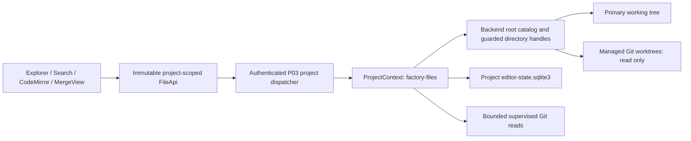

# P05 file service

`factory-files` owns repository access. `factory-projects::ProjectContext.files` owns one service per authoritative P03 project context. React submits intentions; it does not authorize paths. P03 authentication, Host/Origin validation, CSRF, request leases and runtime ownership precede the file router. V1 endpoints and project SQLite schema are preserved.

## Identity and roots

A `FileRef` is `{ project_id, root_id, path }`. Both IDs are mandatory; paths are slash-separated relative UTF-8. A primary root ID hashes project identity, native directory identity, canonical location and available creation metadata. Managed worktree IDs include the project, native directory identity and managed relative location. IDs cannot authorize another project. Renaming a display name does not change a root. Moving/replacing a physical root may change its identity; old drafts are retained and are never silently rebound.

The catalog comes from bounded `git worktree list --porcelain -z`, checked against the canonical project's `.factory/worktrees` directory. Merely sending an absolute worktree path grants nothing. All such worktrees are inspection-only, including inactive ones, until a later ownership protocol permits manual writes. The current engine has no separate integration working-tree service to register. Arbitrary external roots are not accepted.

## Path and trust rules

The portable path grammar rejects empty leaf names, absolute paths, `.`/`..`, repeated separators, backslashes, control characters, alternate-stream colons, Windows reserved device names, trailing spaces/dots and invalid portable filename characters. Maximum relative path: 2,048 UTF-8 bytes; component: 255 bytes. `.git`, `.factory`, `.gitmodules` and `.asf-editor-*` components are protected from ordinary reads and mutations. Configuration retains its controlled existing APIs.

Every parent component is checked. `cap-std` directory capabilities, no-follow file opening, native identity comparisons and revalidation reduce races. Windows directory leases deny delete sharing and reject all reparse-point attributes, including junctions. Unix uses directory-relative capabilities and no-follow opens. Regular files with more than one hardlink are refused, including reads: aliases must not expose or modify outside data. OS permissions still apply.

Manual editor authority belongs to the authenticated local user and the P03 authorized project root; it is not an agent role. Agent role/tool policies are preserved and are not widened by P05. This is not an OS sandbox. Processes running as the local user retain their OS authority.

## Reads and revisions

Responses contain the full file identity, opaque revision, content or metadata, size, modification metadata, encoding, BOM, newline convention, mode and read-only reason. UTF-8, optional BOM, LF, CRLF and absent final newlines round-trip exactly. Mixed LF/CRLF is inspectable but read only. Binary/NUL and unsupported encodings are metadata-only. Large text uses an explicitly bounded read-only preview; a preview can never be saved as the complete file.

`v_…` revisions bind root/path, native file identity, content hash, size and observed timestamps/change metadata. File replacement is detected even when content is identical. This represents observed state, not an immutable history: an external actor restoring all observable content and metadata can produce an ABA ambiguity. Advisory polling never replaces save-time verification.

## Save transaction

1. Resolve the project/root and validate the entire relative path.
2. Acquire the root's nonblocking mutation mutex. Conflicting browser operations receive busy/conflict rather than queued blind writes.
3. Read a bounded snapshot and compare the expected revision; reject read-only content.
4. Journal intent in the private editor database; create a new same-directory temporary file exclusively.
5. Preserve supported permissions/ownership, write exact bytes including BOM, and synchronize the prepared file.
6. Revalidate the expected disk revision and parent identity.
7. Windows uses `ReplaceFileW` with a private backup. Linux uses `renameat2(RENAME_EXCHANGE)`; macOS uses `renameatx_np(RENAME_SWAP)`.
8. Verify replacement identity/content and the displaced original. If an external replacement won the final race, restore it, retaining uncertain versions if verification fails.
9. Synchronize the directory where supported, journal completion, clean up verified owned temporary/backup files and return the new revision.

Windows reader handles are dropped before rollback. The retained replacement is identity-checked before cleanup; an intervening unexpected version is not discarded. Errors after exchange are uncertain outcomes, not ordinary failed writes. Recovery records expose bounded read-only inspection and explicit cleanup; no uncertain save is automatically replayed.

Unix reports `file_and_directory_synced`; Windows reports `file_synced_directory_flush_not_guaranteed`. Windows replacement has platform-specific failure states. Neither the UI nor this report claims universal crash durability. An external process can observe the exchange before post-verification; there is no universal atomic compare-and-swap against arbitrary OS writers. Unix parent-directory relocation and actors with equivalent OS permissions remain residual TOCTOU/trust limits. Network-filesystem kernel stalls cannot be preempted by a browser cancellation.

## Other mutations and recovery

Create is exclusive and never overwrites. Moves stay within one root, refuse destination collisions, validate source revision and parent handles, and verify the moved native identity. A directory move preflights bounded descendants and refuses protected internals or links. Windows ASCII case-only renames use a journaled intermediate name; interrupted intermediates remain recoverable. Non-ASCII filesystem case folding is not asserted universally.

Deletion requires `confirmed: true` and an expected revision. Only empty directories can be deleted. Entries move without replacement to `.factory/editor-recovery`; this is ASF recovery, not OS trash. Restore never overwrites a current entry. Explicit permanent removal deletes only validated retained backup/temporary entries, never the current repository target. A maximum of 128 outstanding recovery records prevents unlimited abandoned operations; completed history retains 500 records. Users can inspect and explicitly purge obsolete recovery data.

The editor sidecar is lazy, transactional schema version 1. A corrupt or foreign existing database is refused and preserved. There is no V1 workflow/configuration/schema conversion. Back up a stopped project, including both databases, recovery entries and existing project/worktree state; do not copy a live SQLite main file while ignoring its journal/WAL.

## Bounds

| Resource | Default | Hard maximum |
| --- | ---: | ---: |
| Editable UTF-8 bytes | 1 MiB | 1 MiB |
| Large-file preview | 64 KiB | 64 KiB |
| Directory response | 200 entries | 500 entries |
| Directory/search scan | 50,000 entries | 50,000 entries |
| Search text read | 16 MiB | 32 MiB |
| Search hits | 100 | 200 |
| Search traversal budget | 2 seconds | 5 seconds |
| Project draft storage | 16 MiB / 128 records | 32 MiB / 256 records |
| File jobs | 4/project | 8/application |
| HTTP file JSON body | 6 MiB | 6 MiB |

`Limits::from_environment` accepts validated `FACTORY_FILE_*` and `FACTORY_EDITOR_DRAFT_*` overrides; exact names are in `types.rs`. SQLite busy waits are bounded at three seconds. A cancellation stops search between bounded operations; it cannot interrupt an in-progress OS syscall. Git reads use `factory-proc` bounds, fixed arguments and no shell; P05 performs no remote Git operation. The common Git directory is pinned by native identity; explicit validated Git/work-tree/common directories prevent a redirected worktree marker from selecting another repository. Windows Git arguments reuse `factory-git::git_path` rather than passing verbatim filesystem prefixes to `--git-dir`. Primary file access remains available with an explicit discovery warning for initialized non-Git V1 projects. Git discovery uses `rev-parse --path-format=absolute` (Git 2.31 or later). Individual Git subprocess deadlines apply separately from the traversal budget.

## Source references

Reviewed 2026-10-28: [cap-std 4.0.3 directory capabilities](https://docs.rs/cap-std/4.0.3/cap_std/fs/struct.Dir.html), [Windows ReplaceFileW semantics](https://learn.microsoft.com/windows/win32/api/winbase/nf-winbase-replacefilew), [Rust filesystem permissions](https://doc.rust-lang.org/std/fs/struct.Permissions.html). Native Windows tests are evidence for this platform; Linux/macOS implementation paths still require native qualification.
