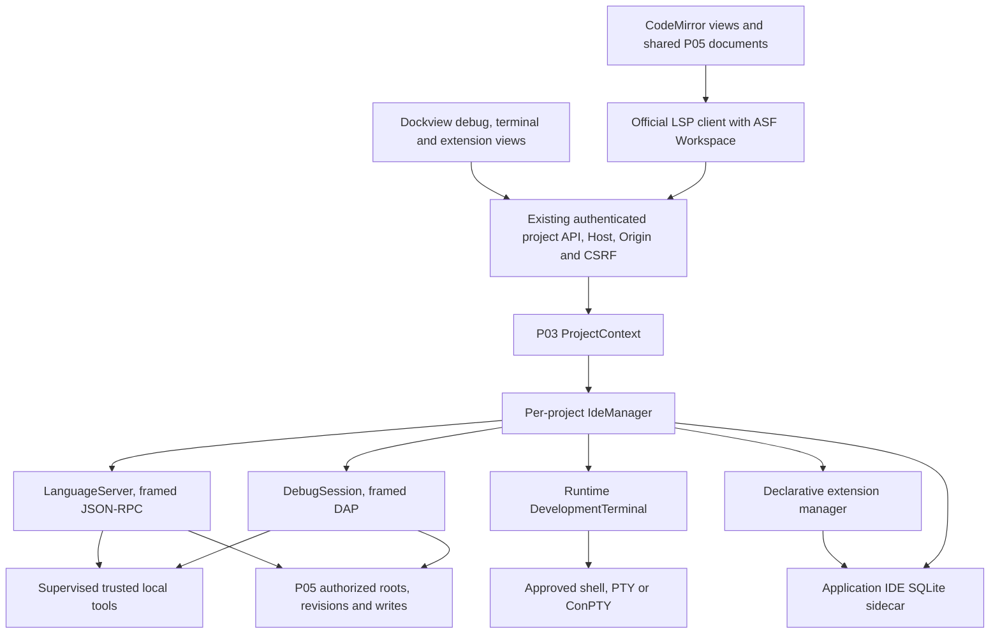

# Rust-owned IDE services

P06 adds `factory-ide`; it does not replace Factory Core or implement P07. The opt-in entry remains `/workspace.html`. V1 remains `/`.

The application owns the shared IDE process budget and metadata connection. Each open project owns its `IdeManager`, file service, LSP map, debugger map and terminal map. String service IDs are looked up only inside that context. No browser selection changes an existing service's project, root or executable. A project cannot close while it has an active IDE service; hiding/moving a presentation tab does not close it.

## Trust and configuration

Profiles are approved explicitly through the protected API. They store a canonical executable, fixed argument vector, languages, optional file patterns, initialization options, tool settings, enabled state and a 500–120,000 ms request timeout. Launch calls select a stored profile ID; they do not accept an executable or command line. Executable bytes and absolute file arguments are fingerprinted, with bounded streaming reads, and rechecked at launch. This does not fingerprint an entire runtime's module dependency tree or prevent a hostile OS user replacing a tool after verification.

The environment is cleared, then populated with a fixed allowlist of OS/user/toolchain location variables. Runtime injection variables such as `NODE_OPTIONS`, `PYTHONPATH`, `LD_PRELOAD`, and model-provider tokens are not inherited. Ordinary Windows runtime-location variables are retained. Canonical Windows identities remain authoritative; process invocation removes the extended-path display prefix because older runtimes may not accept it.

All process roots come from `FileService.process_root`. Managed agent worktrees are read only and cannot host an IDE process launch. Trusted language servers, adapters, debuggees and shells have their OS account permissions; starting in a repository is **not an OS sandbox**. Logical API checks do not contain direct filesystem calls made by these processes.

## Resource and transport bounds

| Resource | Bound |
| --- | --- |
| IDE protocol owners | 16 application-wide; at most 4 LSP and 2 DAP owners per project; trusted tool children are not an OS process-count sandbox |
| Development terminals | 4 per project; share the existing application terminal budget with agent consoles |
| LSP documents | 128 per server, plus P05 editable-file/buffer limits; separate from editor panes |
| Blocking IDE API calls | 16 global, 4 per project; separate 4-request stop lane |
| Protocol frame | 8 KiB header; 2 MiB body; duplicate lengths/malformed framing refused |
| Outgoing protocol queue | 128 messages; enqueue fails rather than blocking a reader |
| Pending protocol requests | 64 per peer; profile request deadline; JSON-RPC cancellation |
| Event history | 128 entries and 4 MiB; cursor and explicit gap indication |
| Browser diagnostics | At most 1,000 per publication with a visible limit label; invalid/out-of-buffer ranges refused |
| Workspace edit | 32 files; 10,000 text edits; 1 MiB resulting content per file |
| Tool stderr events | Count/notification only; raw stderr is withheld from IDE events |
| Declarative package | 128 KiB; 64 contributions; no archive extraction or install scripts |
| Metadata | 128 records per project/kind; audit retains 1,000 attempts per project, reads at most 100 |

LSP and debugger commands use authenticated HTTP requests. Bounded cursor polling delivers asynchronous protocol events without creating a second local HTTP server. Terminals use the existing listener's authenticated WebSocket upgrade. DAP tools requiring TCP are launched by Rust, bound to a private loopback endpoint and supervised; browser requests never choose the adapter's address or port. This endpoint is not an authenticated public ASF service and remains in the local OS trust boundary.

Windows Job Objects supervise protocol process trees and development terminals. Unix protocol tools use process groups; native Unix qualification and abrupt-server-death guarantees remain separate. Readers/writers do not retain a global project mutex while awaiting protocol I/O. Explicit stop wakes pending requests and terminates owned processes. Protocol owners have a two-hour maximum lifetime; manual restart reinitializes and resynchronizes document content. Metadata and workspace restoration do not automatically execute code. Development shells retain their explicit process lifecycle, rather than inheriting a workflow suspension policy.

## Persistence and failure isolation

The sidecar is `registry_path.with_extension("ide.sqlite3")`, next to P03's application registry, outside project repositories. Its versioned schema stores profiles, launch configurations, declarative package artifacts, project activation/preferences and bounded audit metadata. It contains no shell transcript, provider credentials or workflow history. SQLite migrations are additive transactions; no V1 project database is migrated.

Malformed/unknown IDE metadata fails closed for IDE operations. The sidecar is preserved for recovery; a corrupt IDE database must not prevent basic files or V1 workflows from loading. Recovery is explicit restoration of a verified SQLite backup or relocation of the broken IDE sidecar while ASF is stopped; never reset a user's project database. Process instances are transient and are not recreated merely by reading a saved layout.

Profile approval, launch/stop requests and extension lifecycle attempts are audited before their sensitive operation. Entries describe attempts, not fabricated successful outcomes; live service state and actual protocol responses establish results. Raw environment values, source content and terminal input/output are excluded from this audit.

See [LSP](lsp-architecture.md), [DAP](dap-architecture.md), [terminals](development-terminal.md), [extensions](extension-system.md) and the [test matrix](ide-integration-test-matrix.md).
