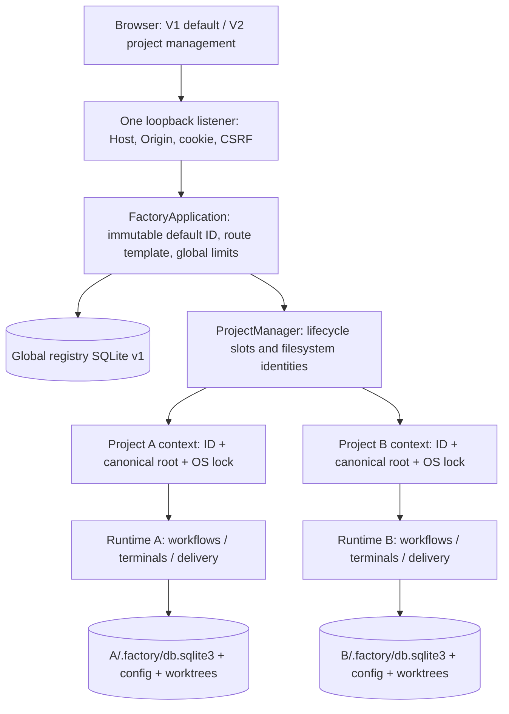

# P03 - Multi-project runtime architecture

Implemented on `codex/v2-p03-multi-project`, based on P02 `the historical private baseline`. Qualification and measured results are in the delivery report (historical record held privately). This is production Rust infrastructure; P04 workspace migration and P10 browser/session suspension are separate phases.

## Ownership

`factory-projects` supplies `ProjectId`, `ProjectRegistry`, `ProjectPathPolicy`, `ProjectManager`, `ProjectContext` and typed errors. It reuses Factory Core, the existing database schema, Git supervisor and runtime lock. There is no second HTTP service and no mutable global current root.

The application owns browser security, an immutable optional startup default, a reusable Axum route template, management permits and request/stream permits. Each authoritative context owns its database connection, canonical directory handle, database file identity and runtime. The runtime retains independent maps for numeric run IDs, terminal IDs and delivery operations. Agent names and configuration are resolved beneath that context's root. Existing canonical-root configuration locks, project-local recipe catalogs, context indexes and MCP databases are retained.

The API strips a validated `/api/projects/<id>` prefix and binds the existing handler router to that context. Original request extensions survive, including WebSocket upgrades. HTTP/SSE bodies and WebSocket state hold an `Arc<ProjectContext>` lease: an idle-looking project cannot close while a live request owns it. Response header `X-Factory-Project` identifies the selected context. A response is never redirected to the startup default after an error.

## Registry

Default location:

| Platform | Location |
| --- | --- |
| Windows | `%LOCALAPPDATA%/AgenticSoftwareFactory/registry.sqlite3` |
| Linux | `$XDG_DATA_HOME/agentic-software-factory/registry.sqlite3`, otherwise `$HOME/.local/share/agentic-software-factory/registry.sqlite3` |
| macOS | `$HOME/Library/Application Support/AgenticSoftwareFactory/registry.sqlite3` |

`factory start --registry FILE` / `FACTORY_REGISTRY` overrides the location. A path containing a `.factory` component is refused. Test registries live in owned temporary application directories. The registry is application metadata, an explicit exception to V1's project-local storage convention.

Schema `PRAGMA user_version=1`: `projects(project_id, canonical_root, display_name, created_at, last_opened_at, registry_schema_version, root_identity, git_identity, database_identity)`. IDs are `p_` followed by 32 lowercase hexadecimal characters from 128 random bits, persisted before returning success. Display-name changes preserve IDs. Root, Git-common-directory and database identities are unique. Listing is ordered by ID, independently of locale or display-name changes.

SQLite WAL, a five-second busy deadline, immediate write transactions, uniqueness constraints and schema/integrity validation provide durable atomic writes. Existing corrupt, unknown, newer-version or missing-table registries are refused; no empty replacement is created. Entries never contain credentials, agent output, workflow history or provider keys. Failed initialization/clone does not create a completed registry entry. Existing data is never reset to repair a failure.

Recovery is explicit: retain the failed registry and its journal, stop writers, restore a verified consistent SQLite backup, or repair a copied database offline. A raw copy of a live WAL database alone is not a verified backup. Removing an entry only deletes its registry row. It does not delete repository files or `.factory` history. Re-registering a deliberately removed repository allocates a new registry identity; relinking a retained entry preserves its identity.

## Paths and identity

Authorized directories are fixed by server startup. The V1 startup root is authorized automatically; additional roots require repeatable `--allow-project-root DIRECTORY`. Browser path entry and `trust_project: true` acknowledge a requested operation but cannot expand this server allowlist. Canonical resolution occurs before containment checks and is revalidated on open and project-scoped request resolution.

Windows identity uses an open directory handle, volume serial and file index. Unix uses device/inode identity. Windows junction and case aliases resolve to one registry entry; relative paths, spaces, Unicode and trailing separators resolve through filesystem canonicalization. DB hard links cannot register independent owners. `.factory`, its DB, config and runtime lock must be real files/directories, without symlinks or Windows reparse points.

Overlapping registered roots and different projects sharing a Git common directory are refused. This prevents cross-repository file visibility and collisions in the existing `factory/run-<id>` / `factory/t<id>` branch namespace. A standalone linked worktree may be registered when its Git common directory is also inside a server-authorized directory, and no other project owns that common directory. It is not an independent second owner of an already registered repository. Windows UNC roots are explicitly unsupported; mapped/network filesystem behavior is not qualified. Non-Unicode paths are rejected rather than silently rewritten.

A new create/clone destination must be absolute, nonexistent and have an existing authorized parent. Registered-root overlap is checked before writing. Atomic directory creation prevents replacing an existing destination. Git runs under the existing bounded process supervisor. Local authorized absolute remotes or credential-free HTTPS/SSH URLs are supported; network clones require `allow_network: true`. Git's existing credentials/helpers remain authoritative. Clone does not push, create a PR, load submodules recursively or introduce provider authentication. Failed new destinations are retained for inspection, with no false registry success. Concurrent external filesystem edits can still invalidate a path between checks; this is a local OS trust boundary, not a sandbox or a complete race-proof filesystem broker.

## Lifecycle and locks

| State | Meaning |
| --- | --- |
| closed | Registered; no runtime owned by this manager |
| opening | Per-project single-flight initialization and lock acquisition |
| open | Authoritative runtime available |
| closing | Exclusive lifecycle mutation or idle teardown |
| unavailable | Last open/mutation failed; precise problem retained |

Filesystem availability (`available`, `not_initialized`, `unavailable`) is reported separately. Missing drives, corrupt project DBs and a broken startup default remain visible; other projects remain usable. Global registry corruption fails closed for every lookup because authoritative identity is no longer trustworthy.

Only a slot lookup uses the global map mutex. Subprocess work and database opening occur outside it. Per-slot condition variables coordinate concurrent opens; waiting callers receive an explicit conflict after 30 seconds. Both `.factory/runtime.lock` and a Git-common-directory `asf-runtime.lock` are held. The latter prevents another linked-worktree/registry owner from reusing the existing branch namespace. OS lock ownership survives through runtime worker clones and is released only after the owner is dropped. A closed-slot relink/removal acquires those same OS locks, preventing a second manager from changing ownership while another instance runs the project. Resolved registry identity is compared with the live context, including after an open.

Close succeeds only when no operation, terminal, delivery, reconciliation or live context lease remains. It does not cancel a session or claim to checkpoint a CLI. Switching projects has no backend lifecycle effect. Unloading is explicit and idle-only; registered projects are opened lazily, except the configured startup default. Startup reconciles interrupted work through existing DB transitions, revokes temporary MCP grants and marks uncertain deliveries interrupted. It does not replay publication. Runtime opening preserves existing worktrees, including clean worktrees; explicit existing CLI cleanup operations remain available.

## Resource limits

Default application caps: 128 registered projects, 8 open runtimes, 8 total workflow/planning/delivery operations, 8 terminal processes, 2 concurrent management operations and 64 project requests/stream bodies. Embedders can set `ProjectLimits`; the CLI currently uses these defaults. Zero operation/terminal capacity disables those operations; registry/open/management capacities must be positive. Future LSP/DAP/extension processes must join global accounting in P06.

RAII operation/terminal permits are acquired before creating durable run rows or delivery claims and released on completion/error. Per-project agent policies and concurrency rules remain enforced by Core. A global cap never grants a capability denied by a project policy. Terminal subscriptions retain their existing history, queue and subscriber bounds. There is no unbounded polling task per registered project. Existing terminal and session streams operate only for opened resources.

## Boundaries

Logical project isolation does not restrict an external CLI's underlying OS privileges. A trusted local user can edit repositories, SQLite files or the registry outside ASF. Revalidation catches stable replacements; hostile concurrent replacement, network-filesystem semantics and arbitrary child descendants require separate OS/process containment work. P03 does not claim an OS sandbox, crash-resumable CLI memory, P10 session leases, automatic mission suspension, P04 tabs or P06 IDE services.
