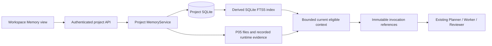

# Structured project memory (P11)

`factory-memory` is an application service over the existing project SQLite database, P05 file service, policy resolver and Git evidence. `factory-types::memory` defines versioned records; `factory-db::memory` owns transactional persistence. `Factory::invoke_with_agent` selects and audits memory before using the existing CommandAgent. There is no second scheduler, model gateway, global knowledge database or mandatory embedding service.

## Storage and identity

Additive migration 23 adds current memories, append-only revisions, settings/generation, candidates, extraction records, deletion fingerprints and invocation usage. It uses the existing verified pre-upgrade backup and future-schema refusal. Earlier runs, conversations, profiles, checkpoints and agent histories are not rewritten. A downgrade requires a stopped, consistent pre-upgrade backup and separate reconciliation of later worktrees and integration records.

The registered P03 project ID is bound to one memory store. `pm_`, `mc_` and `me_` IDs are random stable identities, not titles or run IDs. Identical titles across projects are independent. Legacy standalone Core/CLI executions without a registered project identity preserve their existing behavior and do not implicitly acquire another project's memory.

Built-in categories are architecture, technical decisions, coding conventions, project constraints, dependencies/infrastructure, known issues, previous failures/lessons, project preferences and general facts. Category labels never grant or revoke a tool.

Active records may enter context. Disabled records remain editable but are excluded. Stale records need source/claim review. Disputed records represent unresolved scoped claims. Superseded records retain history but are excluded. Deletion removes the record and revisions; it is a separate operation.

## Bounds

Titles are 180 bytes, content 8192 bytes, subject 120 bytes, component scope 200 bytes, with at most eight sources. Each record retains at most 256 revisions. The project admits 20,000 current records, 20,000 candidate records, 10,000 extraction operations and 100,000 invocation audit rows. The accounted revision/candidate/usage payload budget is 128 MiB; it is not the entire SQLite file size or a bound on existing workflow storage. Limits fail explicitly and do not silently prune history.

Search/list pages contain at most 100 records; the UI asks for 50. Revision pages contain 50. Candidate pages contain 50, and usage/history endpoints are bounded. Long histories are loaded on demand. Search is derived and can be rebuilt without replacing authoritative records. There is no browser-side authoritative memory cache.

P07 conversation and P08 planning/replanning/execution use the shared invocation path. P09 snapshots retain original configuration, while memory usage is independently revisioned. P10 checkpoints contain no cached memory text: a new invocation retrieves current eligible records after explicit validated resume. P10's manual resume and 180/60-second default presence timings are unchanged.

Executed qualification and platform/CI limits belong in V2-P11 (historical record held privately), not in architectural promises.
