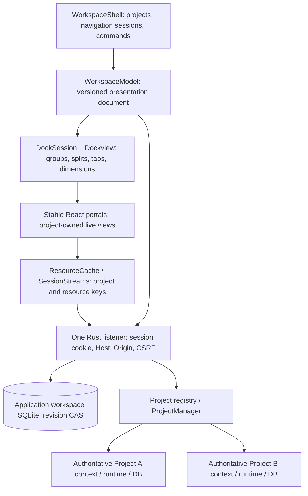

# Production workspace architecture - P04

The opt-in production entry is `/workspace.html`, built with V1 `/index.html` and P03 `/projects.html` into the same Rust-hosted assets. `v2.html` remains the isolated P02 fixture preview. Production modules never import the preview controller or its fixtures. The P01 CodeMirror/Dockview/Rust decision is unchanged.

## Identity and ownership

`production/model.ts` defines document version 2. Workspace IDs are `w_` plus 32 lowercase hexadecimal characters; navigation sessions use `s_`, views use `v_`. Generation uses browser `crypto.randomUUID`; decoding validates identity, uniqueness, references, bounded fields and supported versions. Project IDs remain the authoritative P03 `p_` identities. Labels, file names and tab positions never determine ownership.

A workspace stores open-project order, navigation sessions, the active session/project and theme preference. A navigation session has a primary project, title, ordered view records, Dockview layout, selected view, activity, preset, timestamps and a monotonic last-activation counter. Reopening a project selects its most recently activated navigation session independently of clock resolution. View records retain their own project and navigation-session IDs, kind, optional numeric resource, title, presentation state and closed/hidden flags. A numeric workflow ID and a numeric agent-process session ID are distinguished by view kind and API route.

Three session concepts remain separate:

| Concept | Owner / purpose |
| --- | --- |
| Browser authentication session | Existing Rust security policy and cookies |
| Workspace navigation session (`s_...`) | Presentation document; independent tabs/layout/state |
| `AgentSession` numeric ID | Existing project DB/runtime; process, output and terminal ownership |

There is no new conversation, mission, scheduler or agent-process schema. Navigation never implements workflow pause/resume. Hiding a session or closing a tab changes presentation only. Existing V1 session/process operations remain explicit domain commands.

## Dockview integration

`DockSurface` uses pinned Dockview 8.7.0 public content/tab/header factories, events, `addPanel`, `moveTo`, `setSize`, `toJSON` and `fromJSON`. Dockview owns the split tree and pointer interactions. The shared P02 theme was extracted into `workspace/shell/dock-theme.css`; both preview and production consume it. No workbench fork, internal DOM rewrite or parallel CSS layout engine is used.

Content renderers keep one container per view ID. React portals stay attached to those containers while a preset rebuilds the Dockview tree. Hidden views retain their React content; closing a view removes its content/subscriptions while retaining its presentation record and draft. Switching navigation sessions unmounts the old dock instance and reconstructs the destination from its model, without issuing execution commands. Views use `renderer: always`, with explicit cleanup of observers, subscriptions and editor/terminal instances.

Each serialized tree is validated and reconstructed from an allowlist before loading. Arbitrary components, parameters, floating groups, popouts and unsupported edge layouts are refused. The production component is always `workspace`, the tab renderer is `asf`, and minimum sizes are rederived from the view kind. Corrupt trees recover to the selected preset with view records and drafts retained. See [persistence](layout-persistence.md).

## View registry and live data

| Kind | P04 behavior |
| --- | --- |
| home | Actual project identity and recent workflow summaries; explicit P07 conversation boundary, no composer |
| workflows | Scoped paginated run API, 100 fetched rows, 20 displayed rows per local page, `before` cursor |
| workflow / progress | Actual run/task/attempt/session state; task counts rather than estimated percentages; existing start action |
| agents | Project-local configuration/roles and recorded process sessions |
| console | Existing authenticated project/session SSE; recorded output and status |
| terminal | Existing authorized interactive agent session over its scoped WebSocket; no process creation endpoint |
| search | Existing boundary-controlled context search API; no file read/write service |
| sourceControl / review / tests | Actual integration branch/head and recorded artifacts; no invented Git status, diff or passing tests |
| explorer / code | Truthful P05 boundaries, actual canonical project metadata and access to workspace notes |
| scratch | CodeMirror workspace note; text/selection/scroll stored in the workspace, never a repository file |
| settings | Theme and navigation help, plus explicit project-scoped V1 settings access |
| editor / diff / diagnostics / extensions | Registered future contracts; disabled creation actions until their actual services exist |

The canonical type/titles registry is `production/model.ts`. The note editor exercises dirty-state and close-confirmation contracts for P05 without a filesystem write. The 65,536-character limit is enforced before insertion; close retains the draft in the view record. It is not a production code-file editor, LSP client or project memory service.

## Request, stream and process lifetimes

`projectPath` validates the project ID. Every project-specific read or mutation includes it explicitly. `ResourceCache` keys contain the complete project-prefixed path, including query/cursor; subscriptions deduplicate identical requests, cancel the last reader, and poll only subscribed resources (workflow reads 2.5 seconds; registry/configuration 10 seconds). Responses update their original key, never a mutable active-project slot. Project opening uses a navigation generation so a late result cannot supersede a subsequent selection.

`SessionStreams` keys are project ID plus numeric process-session ID. One EventSource serves multiple readers of that pair. A 100 ms unsubscribe grace accommodates transient remounting; stale-source events and mismatching session IDs are rejected. An error retains a clear reconnect action. Switching or closing a view unsubscribes that view; it does not stop its process or other subscribers. Terminal adapters bind their socket to the same explicit pair; input/resize/reconnect use the existing Rust protocol. Theme changes update xterm options without replacing the socket.

The browser owns no process, Git worktree, execution checkpoint or policy. Rust P03 ownership, request leases, resource caps and security middleware remain authoritative. A saved document cannot authorize a project, start a workflow, create a terminal or publish anything. Restoration performs presentation reads and workspace saves. Closed project runtimes require an explicit Open action after restart; missing resources show scoped errors rather than a fallback into another project.

## Compatibility and qualification

V1 stays the default application. The explicit `/?project=<p_id>` compatibility entry binds the existing V1 API client to that project for the document lifetime; authentication remains `/api/auth/session`. V1 without that parameter retains P03's immutable default. Malformed scope is refused by Rust, never redirected to the default. Agent Graph, workflows, configuration, roles, recipes, consoles, MCP, performance and delivery remain in V1 without copying their business logic into the workspace.

The empty 202 response of the existing terminal-stop API is handled as accepted rather than invalid JSON. No backend response/status contract changed. Workspace metadata uses a separate application database; all project schemas, migrations and V1 data remain in place. Publication, session suspension, general-purpose terminal services, files/LSP/DAP/extensions, conversations and orchestration changes remain P05-P14 work.

Executed evidence and native/platform limits are recorded in the P04 delivery (historical record held privately). Passing browser automation is not native assistive-technology, OS sandbox or all-platform qualification. The [official Dockview loading contract](https://dockview.dev/docs/core/state/load/) was consulted on 2026-10-27 and checked against the pinned package declarations; sanitization and recovery are ASF responsibilities.

## P05 production file views

`factory-files` is now attached to each P03 project context. Explorer, Search, editor and read-only MergeView use immutable project/root/path references. `DocumentManager` owns shared buffers outside Dockview; panel remounts do not own filesystem writes. Workspace JSON version 3 stores file/draft references and presentation state, while a separate project SQLite sidecar and bounded IndexedDB journal store unsaved documents. P04 version 1/2 layouts migrate; workspace notes retain their existing behavior.

The primary root supports guarded writes; managed agent roots are read only. Saves require an observed revision and an acknowledged backend result. Existing agent consoles, event streams, workflows and legacy links are unchanged. P05 introduces neither conversation execution nor suspension semantics. See [file service](file-service-architecture.md), [document model](editor-document-model.md), [API](filesystem-api.md) and [test matrix](editor-test-matrix.md). Historical P04 integration-boundary descriptions above describe the prior delivery; this section supersedes their P05 explorer/editor/search limitations.

## P06 production IDE views

`WorkspaceModel` now owns `LanguageManager` and `DebugManager` outside Dockview component lifetime. The real `diagnostics`, `debug`, `developmentTerminal`, `extensions` and `extensionView` views use the same project-scoped cache, public docking APIs and P02 controls/tokens. IDE tool approval lives in Settings. Agent terminals retain their separate session identity and policy; development-terminal views reference opaque Rust terminal IDs.

Language/debug connections are keyed by project/root/service and cleaned up when the workspace model is disposed. View movement reuses service state. Hiding a view disconnects its subscriber where appropriate, not its backend operation. Restored layouts reference existing transient services but never launch a shell, debugger, language server or extension process automatically. After backend restart the user sees missing/exited services and can explicitly restart them; profiles/configurations/extension activation metadata remain durable.

The browser uses the official CodeMirror LSP client with a shared-document workspace and an ASF transport facade. Rust performs external initialization exactly once. Cursor-based bounded event polling publishes changes only when events/state change, rather than causing idle global React renders. Terminal views reuse the existing lazy xterm implementation, fit/search addons and authenticated sockets. Theme changes update terminal/editor styling without starting new tools.

No competing workbench or editor navigation system is introduced. Definition, references, symbols, debugger source and extension command navigation use the existing `DockSession`. Late language navigation checks the owning visible project; it cannot replace another project's active view. P07 conversation execution remains unavailable.

## P07 central orchestrator and mission views

The existing `home` panel now hosts the production `ConversationPanel`; its optional `state.conversationId` is validated inside workspace schema 3. Navigation sessions, conversations, runs and numeric AgentSessions remain separate identities. Selecting or opening a conversation beside another panel does not create a workflow. Restoring a layout performs reads and SSE subscription only. Closing, moving or hiding a conversation never cancels its command or run.

`ConversationStore` is keyed by immutable project/conversation IDs. Multiple panels share one ref-counted event subscription and ordered message snapshot; idle stores are evicted within a 128-entry bound. Fetch results cannot migrate into a different key. A refresh requested while another is pending is replayed after it completes. History initially fetches 50 messages and can append older pages up to 200 visible messages. The complete history stays in project SQLite.

The composer persists its text and uncertain submission key separately from layout JSON, under window-owner/project/navigation-session/conversation identity. Explicit Retry reconciles the same durable command. Copying a failed objective into the composer is distinct from executing it. File context uses P05 roots/revisions and, when selected, the current shared unsaved buffer and UTF-8 selection range. A draft is never saved merely by attaching it.

The separate `progress` panel reads authoritative conversation/run snapshots: tasks completed/total, actual status, responsible roles, sessions, attempts and evidence links. A selected run still opens the existing detailed workflow view. The form and executable graph are lazy-loaded and use the same mission endpoint. The graph edits actual `Plan` data, with a keyboard task-list alternative. V1 configuration, Agent Graph, workflow inspection, agent consoles and delivery remain accessible through scoped compatibility links.

The default Progress view follows an explicit conversation selection within the same project/navigation session. Resource-specific Progress views remain fixed to their explicit run. Inspecting an existing project run persists a snapshot reference and exposes scoped progress/evidence links without making the conversation command own that run. The default conversation list reports missions started from that conversation; a read-only reference does not create or cancel one.

Rust owns processing independently of subscribers. Final structured CLI responses are shown after actual completion, not simulated token streaming. P07 does not suspend on browser disconnect, dynamically parallelize an individual run, install a new model gateway or implement project memory. Those boundaries remain P08-P11. Earlier P04-P06 conversation-unavailable statements above describe those historical deliveries and are superseded by this section.

## P08 progress integration

P09 adds lazy Agent Management inside the existing Agents view, retaining legacy session consoles. The editor uses scoped APIs, expected revisions and retained drafts on conflicts. Provider availability is a local executable observation, not a quota guarantee. Progress and workflow details expose persisted handoff state/history. Agent consoles inspect immutable snapshots and separate native model observations. Components and requests remain keyed to project/run identity. Dockview and shared document ownership are unchanged. See [handoff semantics](agent-handoff.md) for supported boundaries and P10 exclusions.

`MissionProgress` renders active task stages, real concurrent counts, revision/task/dependency history, Planner session links and serialized integration outcomes from project-owned P07 snapshots. `AttemptEvidence` includes captured base/head/patch-hash facts. Existing CodeMirror and Dockview ownership remains unchanged. The Filesystem root selector can inspect the latest integration snapshot separately from the main working tree and agent task worktrees; all such managed roots are read-only.

## P10 explicit lifecycle ownership

The application shell owns one browser-presence manager for its lifetime. All restored workspace sessions associated with open project contexts are bound, including inactive navigation sessions. Project switching, hidden views, editor closure and conversation panel unmount do not release presence or suspend missions. A pinned panel targeting another project uses that project's durable session identity when submitting a mission.

`Close session` is distinct from existing presentation `Hide` actions. Its confirmation describes affected mission reconciliation and preserved evidence. Reopening clears close intent; `Validate and resume` separately authorizes execution. Mission Progress presents backend lifecycle, checkpoint, process and recovery data. During a connection failure it labels cached lifecycle data as last confirmed. Shared LSP, development terminals and debugger ownership retain their P06 lifecycles; they are not indiscriminately killed by mission suspension.

## P11 project memory integration

P11 adds a lazy Memory view to the existing Activity Rail and P04 persisted layout. The project ID is captured by each request; obsolete reads are aborted, and edit drafts survive revision conflicts. Invocation memory audit loads only on expansion. See [memory architecture](project-memory-architecture.md).

## P12 Source Control and Review

The existing Source Control and Review Dockview views now use lazy production components backed by project-scoped Rust Git/review APIs. CodeMirror comparisons share P05 rendering. Manual index/commit/branch operations target only the primary writable root, protect live buffers and persisted drafts, and refresh document revisions after checkout. Managed worktrees remain inspection-only. GitHub reads are explicit; a delivery preview cannot publish or restart a suspended mission. See [Source Control architecture](source-control-architecture.md).

## P13 product consolidation

Dockview and version-3 workspace documents remain authoritative for presentation. Settings, Notifications and the typed command palette integrate through existing views/actions; application preferences use the existing WorkspaceStore with their own CAS revision. Saved notification panels, settings categories and mission-form presentation never replay execution. Global Settings also opens without an active project. Readonly resource navigation verifies the owning project/run and fences stale navigation. P05 CodeMirror preference compartments retain buffers, selections, history and write policy. See [product navigation](product-navigation.md) and [settings architecture](settings-architecture.md). P10 remains manual-resume at its existing180/60 defaults.
